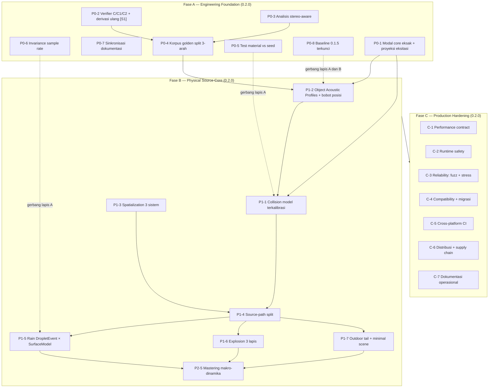

# QINARI 0.2.0 — MASTER ENGINEERING PLAN (v2)

| Bidang | Nilai |
|---|---|
| Dokumen | QINARI-0.2.0-MASTER-ENGINEERING-PLAN |
| Versi | v2 — menggantikan v1 (distribusi sebelumnya sebagai `qinari-0.2.0-plan-doc`) |
| Basis kode | qinari 0.1.5, HEAD `b49218a` (dirilis 2026-11-07) |
| Tanggal v2 | 2026-11-08 |
| Status | Dokumen perencanaan implementasi. Belum ada production sign-off. |
| Lisensi ruang kerja | GPL-3.0-or-later (workspace, `Cargo.toml`) |
| Metode v2 | Revisi v1 atas verdict review eksternal independen; setiap koreksi diverifikasi ulang terhadap sumber primer atau ditandai sebagai blokan verifikasi. Temuan audit F1–F21 dipertahankan utuh. |

## Riwayat revisi

| Versi | Tanggal | Pemicu | Perubahan kunci |
|---|---|---|---|
| v1 | 2026-11-08 | Audit forensik 0.1.5 (F1–F21), tiga jalur bukti | Dokumen dasar: 10 bab, 5 fase, 21 temuan terverifikasi |
| v2 | 2026-11-08 | Review eksternal independen atas v1: kualitas engineering plan 8,4/10; kesiapan production release plan 6,2/10; production sign-off **NOT APPROVED**. Rekomendasi review: pertahankan 21 temuan, perbaiki spesifikasi yang keliru, buat dependency graph resmi, tambah bab kontrak rilis produksi | (1) Eksitasi modal dan normalisasi didesain ulang; satuan kriteria T60 dibetulkan. (2) Parameter filterbank verifier menjadi blokan derivasi-ulang dari primer. (3) Evaluator dipisah per kategori suara. (4) Model hujan dirombak menjadi `DropletEvent × SurfaceModel`. (5) Impor modal menjadi *Object Acoustic Profiles* per objek. (6) Metodologi dengar dirombak menjadi Test A/B/C. (7) Dependency graph resmi + jalur kritis + model effort. (8) Korpus dan hold-out diperkuat (split tiga-arah, statistik kuantil). (9) Bab baru: Kontrak Rilis Produksi. (10) Bab baru: Go/No-Go 0.2.0. |

**Daftar isi.** 1 Ringkasan — 2 Metodologi — 3 Temuan F1–F21 — 4 Diagnosis Akar — 5 Desain — 6 Ground Truth — 7 Roadmap v2 — 8 Kriteria Kalibrasi Ulang — 9 Kebijakan Baseline — 10 Kontrak Rilis Produksi — 11 Go/No-Go — 12 Risiko dan Keputusan — 13 Bibliografi — 14 Lampiran.

---

# 1. Ringkasan Eksekutif

## 1.1 Posisi v2 terhadap v1 dan review eksternal

v1 direview oleh pihak eksternal secara independen (2026-11-08). v2 menerima seluruh koreksi yang dapat diverifikasi, menandai yang belum bisa diverifikasi sebagai blokan, dan menambah bagian yang tidak ada di v1. Angka penilaian review dicatat apa adanya sebagai pemicu revisi — bukan sebagai angka yang disahkan dokumen ini.

**Tabel 1a. Penilaian review eksternal atas v1 dan tindakan v2**

| Bagian v1 | Nilai review | Tindakan v2 |
|---|---|---|
| Forensic audit F1–F21 | 9,2 — sangat kuat | Dipertahankan utuh (Bab 3), verifikasi silang ulang pada HEAD |
| Root-cause diagnosis | 9,0 | Dipertahankan (Bab 4) |
| Physical Acoustic Architecture | 8,7 | Diperbaiki: hujan per-permukaan, dekomposisi propagasi (Bab 5, 7) |
| Ground-truth strategy | 8,0 | Diperkuat: sizing berbasis variansi, split tiga-arah (Bab 6) |
| DSP implementation plan | 7,5 | Spesifikasi keliru diperbaiki (Bab 7: P0-1, P1-1, P1-2) |
| Verifier architecture | 7,8 | Koreksi konseptual + blokan derivasi ulang parameter [S1] (Bab 7: P0-2) |
| Roadmap & dependencies | 7,5 | Direstrukturisasi: dependency graph resmi, jalur kritis, effort (Bab 7) |
| Perceptual testing | 6,0 | Didesain ulang: Test A/B/C, anchor lengkap (Bab 6–7) |
| Performance & reliability | 4,5 | Bab baru (10) |
| Production/release engineering | 3,8 | Bab baru (10) + Go/No-Go (11) |

Tiga keputusan review atas v1: sebagai *research & engineering blueprint* — **approved** (v2 mempertahankan arah); sebagai *implementation roadmap* — **conditional** (v2 adalah pemenuhan kondisinya); sebagai *production release specification* — **not approved yet** (berlaku sampai checklist Bab 11 hijau dengan bukti).

## 1.2 Posisi rilis 0.2.0 — Physical Source & DSP Core

Arah program Qinari tetap **Physical Acoustic Engine** (multi-rilis, 0.2.x–0.3.x). Nama rilis 0.2.0 diubah menjadi:

> **Qinari 0.2.0 — Physical Source & DSP Core.** Fondasi prosedural yang stabil: sintesis modal terkoreksi, pembangkit benturan sadar-material, spasialisasi sumber, jalur akustik terpilih yang terukur, dan evaluasi audio tervalidasi eksternal.

Konsekuensinya, 0.2.0 **tidak** mengklaim: scene graph penuh, propagasi atmosferik ISO, reverb geometris ruangan, oklusi berbasis scene, sistem Doppler penuh, seluruh keluarga sumber natural, parameter refinement otomatis, maupun harness ABX/MUSHRA formal. Semua itu menjadi 0.2.x dan 0.3.x (Bab 7.9). Ini bukan penurunan ambisi; ini membuat nama rilis sama luas dengan buktinya.

## 1.3 Kesimpulan audit 0.1.5 (dipertahankan dari v1)

Qinari 0.1.5 adalah **mesin variasi statistik yang kompeten, tetapi bukan engine akustik fisik** — determinisme, LatentField, proses Cox, dan test yang lulus membuatnya stabil dan konsisten, namun suaranya masih generik karena empat hal yang tidak berkaitan dengan mesin statistiknya: (1) verifier mengukur karakteristik yang berbeda dari yang dijanjikan, (2) resep bukan model sumber fisik yang utuh, (3) ruang dan propagasi hampir sepenuhnya absen, dan (4) tidak ada ground truth dari dunia nyata yang menjadi target. Rencana 0.2.0 karenanya bukan menambah resep, melainkan membangun ulang fondasi — verifier dan ground truth diperbaiki lebih dulu, baru DSP, baru dunia akustik.

## 1.4 Angka kunci 0.1.5 — verifikasi ulang pada HEAD `b49218a`

**Tabel 1b. Angka kunci hasil audit (dipertahankan dari v1)**

| Aspek | Temuan terukur | Konsekuensi |
|---|---|---|
| Perbedaan antar-material impact | Jarak spektral antar-material 0,03–0,06 dB; antar-seed 2,34–2,69 dB. Seed lebih berpengaruh daripada material. | Parameter material praktis tidak terdengar. |
| Decay modal | Metal t60 dideklarasikan 0,74 s; terukur mencapai −60 dB dalam 45 ms (16,8–124x lebih pendek untuk semua mode). | Semua resep modal (impact, hit, sword, footsteps) mewarisi decay yang salah. |
| Penguji t60 | Satu-satunya test decay hanya memeriksa batas −34 dB; lolos dengan margin sekitar 10 pangkat 20. | Test tidak bisa gagal karena decay salah. |
| Ruang akustik | 25 dari 30 resep sepenuhnya kering. | Ciri khas rekaman anechoic — tell sintetis paling mudah didengar. |
| Verifier | C1 dilabeli tetapi diimplementasikan sebagai korelasi Pearson envelope dB; C2 dan AC tidak ada; analisis pada mono mixdown. | Optimasi menuju metrik yang salah (Goodhart). |
| Ground truth | Tidak ada berkas golden ter-commit; CLI tanpa `verify`/`refine`; golden.rs menargetkan diri sendiri. | Target statistik murni tebakan tulisan sendiri. |
| Benchmark internal | 3 dari 9 metrik justru memburuk setelah migrasi realism (thunder peak/mean 451,8 → 642,4). | Kemajuan tidak dibuktikan terhadap dunia nyata. |

**Tabel 1c. Verifikasi ulang v2 pada HEAD (metode mekanis, 2026-11-08)**

| Item | Nilai pada HEAD | Metode |
|---|---|---|
| Jumlah test | **486 atribut `#[test]`** pada 60 berkas; 57 modul `#[cfg(test)]`. v1 mencatat 237 test lulus dari sesi build pemilik proyek — angka itu **belum terekonsiliasi** dengan 486 dan dicatat sebagai batas (Bab 2.3) | hitung atribut per berkas `.rs` |
| CLI | 13 subcommand (`setup sfx ambient music tts master analyze bench info interactive config completions doctor`); **tanpa `verify`, tanpa `refine`** — F17 terkonfirmasi ulang | `qinari-cli/src/main.rs:49–76` |
| Workspace | 7 crate (`dsp audio sfx music tts verify cli`); **tanpa `qinari-graph`** — F17 terkonfirmasi ulang | `Cargo.toml [workspace]` |
| MSRV | **1.92** (`rust-version`), diuji job CI `msrv` pada 1.92.0 eksak | `Cargo.toml`, `ci.yml:14–22` |
| Optimizer eksternal | **Tidak ada** `argmin`/`cmaes` di manifes maupun `Cargo.lock` | daftar dependensi workspace |
| Resep | Registri `static RECIPES: [Recipe; 30]`; 31 kemunculan `Recipe {` = 1 definisi struct + 30 entri — F19 konsisten ulang | `recipes.rs`, hitung pola |
| Temuan kode kunci | F1 (`modal.rs:132–150` decay ganda + komentar janji −60 dB), F3 (`recipes.rs:253–267` normalisasi 0,7), F7 (`recipes.rs:372–395` tiga uniform independen: berat 8% 900–1600 Hz / normal 92% 2200–6700 Hz), F9 (`recipes.rs:625` `fast_sine(0.055t)`, pan 0,0), F13 (`modulation.rs:165–180` Pearson `band_db` antar pita) | pembacaan langsung HEAD, sesi v2 |
| CI | 6 job Linux: `msrv`, `check` (fmt + clippy `-D warnings`), `test`, `tts-live` (instalasi voice terverifikasi SHA-256), `deny` (cargo-deny licenses/advisories/bans), `build` (release + bench + smoke). **Belum ada matriks Windows/macOS** | `ci.yml` |
| Rilis | Tarball `x86_64-unknown-linux-gnu` + sidecar `.sha256` terverifikasi `sha256sum --check` | `release.yml` |
| Lisensi dependensi | cargo-deny aktif: allowlist SPDX, `wildcards = deny`, `yanked = deny` | `deny.toml` |

## 1.5 Sepuluh perubahan prioritas (bahasa review) dan pemetaannya di v2

| Prioritas | Perubahan | Bab v2 |
|---|---|---|
| 1 | Perbaiki desain eksitasi dan modal bank | 7.5 (P0-1), 8 |
| 2 | Betulkan spesifikasi C1/C2/AC | 7.5 (P0-2), 2.4 |
| 3 | Pisahkan evaluator per kategori suara | 5.3 |
| 4 | Ubah model hujan menjadi surface-specific | 7.6 (P1-5) |
| 5 | Perbaiki ekstraksi modal dan strategi residu | 6.2, 7.6 (P1-2) |
| 6 | Ubah metodologi listening test | 6.4, 7.8 (P4-2) |
| 7 | Dependency graph resmi | 7.2 |
| 8 | Perkuat korpus dan validasi hold-out | 6.1 |
| 9 | Tambahkan performance, runtime safety, reliability | 10 |
| 10 | Release engineering dan Go/No-Go | 10–11 |
# 2. Metodologi Verifikasi dan Status Bukti

## 2.1 Tiga jalur bukti (dipertahankan dari v1)

Setiap temuan di Bab 3 ditopang minimal satu jalur bukti, dan sebagian besar ditopang dua atau tiga:

- **Audit forensik kode (read-only).** Pembacaan penuh workspace `crates/qinari-*` dengan bukti berupa jalur berkas dan nomor baris, kutipan kode, serta hitungan matematis (radius pole resonator, prediksi envelope, port simulasi numerik). Tidak ada berkas yang diubah.
- **Pengukuran independen oleh pemilik proyek.** Toolchain Rust via conda-forge, baseline dibangun (v1 mencatat 237 test lulus — lihat batas di 2.3), lalu render diukur langsung: impact 4 material × 6 seed, envelope ModalBank per material, audit sumber reverb, musik, dan chain mastering.
- **Verifikasi literatur dengan sumber dibuka.** Setiap rujukan dibuka teksnya (PDF penerbit, halaman ISO/ITU, GitHub, atau salinan akses terbuka), bukan dikutip dari ringkasan pihak kedua. Bibliografi Bab 13 menandai PRIMARY (dibuka langsung) dan SECONDARY.

Label status: **CONFIRMED** (bukti kode dan/atau angka mendukung penuh), **PARTIAL** (sebagian benar, dengan koreksi), **NOT VERIFIED** (belum ada sumber yang bisa dibuka; diperlakukan sebagai hipotesis).

v2 menambah satu praktik: **verifikasi ulang mekanis pada HEAD** (Tabel 1c) — hitungan atribut test, pembacaan ulang lima titik kode yang dikutip temuan, pembacaan ulang manifes, CI, dan alat rilis. Semua angka pada Bab 1c berasal dari praktik ini, bukan dari memori.

## 2.2 Koreksi terhadap review

v1 sudah mengoreksi review eksternal pertama. v2 kini mengaudit review eksternal kedua (review yang memicu revisi ini) dengan cara yang sama: klaim review adalah klaim, bukan bukti, sampai diperiksa terhadap sumber.

**Tabel 2a. Koreksi v1 atas review pertama (dipertahankan)**

| Klaim awal | Hasil verifikasi | Status |
|---|---|---|
| Model auditori McDermott-Simoncelli memakai 32 kanal koklea | Paper aslinya: 30 filter koklea berspasi ERB, 52–8844 Hz (Neuron 71(5):926–940, 2011) | PARTIAL |
| Kutipan Neuron 72(1):201–218 | Sitasi benar: Neuron 71(5):926–940, 8 September 2011 | Dikoreksi |
| Tekstur hasil model statistik penuh tak terbedakan dari rekaman asli | Paper: identifiability *mendekati* rekaman asli; air sering realistis bahkan dari statistik marginal saja | PARTIAL |
| Studi modal-dari-rekaman (tak disebut sumbernya) | Pauletto dan Barahona, SMC 2019 — 100 mode per material plus residu; test pendengar tak terbedakan | CONFIRMED |
| Pumphrey dan Crum 1989 (dua penulis) | Tiga penulis: Pumphrey, Crum, dan Bjoernoe, JASA 85(4):1518–1526 | Dikoreksi |
| Tetesan di permukaan berbeda menghasilkan bunyi kategorik berbeda | Belum ada sumber terbuka yang mendukung; diperlakukan sebagai hipotesis desain | NOT VERIFIED |
| ESC-50 bebas dipakai | ESC-50: CC BY-NC; subset ESC-10 CC BY | PARTIAL |
| Freeverb 0 pemakaian | 0 di qinari-sfx; 2 gaya di qinari-music | PARTIAL |

**Tabel 2b. Audit v2 atas klaim review kedua (pemicu revisi ini)**

| Klaim review kedua | Verdict v2 | Bukti / koreksi |
|---|---|---|
| Kriteria v1 P0-1 `|T60_ukur − t60_deklarasi| < 1 dB` salah satuan | CONFIRMED | v1 menulis persis demikian (Bab 7.1 v1). T60 besaran waktu (detik); v2 memisahkan: error relatif T60 (% / detik) dan *envelope fit error* (dB) — Bab 8 |
| Normalisasi per-voice terhadap puncak IR tiap mode berisiko menghapus rasio amplitudo antar-mode | CONFIRMED (risiko desain) | v1 P0-1 checklist + catatan Qinari-X; v2: normalisasi hanya gain global / parameter coupling; *relative modal gain* hasil pengukuran dipertahankan |
| Eksitasi harus diproyeksikan ke tiap mode (`q_n(t)=∫h_n(t−u)F(u)du`), bukan sekadar fase dari korelasi pulsa | CONFIRMED (koreksi desain) | v1 P0-1 hanya menulis fase awal dari korelasi bentuk pulsa; v2 menambah proyeksi + kuadratur per mode — 7.5 |
| Kriteria RMS −40 dB jendela 200 ms terlalu longgar untuk mode t60 0,74 s | CONFIRMED (hitung) | Pada 200 ms, mode T60 0,74 s yang benar terbaca ≈ −16 dB; ambang −40 dB masih lolos pada T60 efektif ≥ 0,3 s (≈2,5x terlalu cepat). v2: kriteria slope per mode — 8 |
| Residual paper [S11] disimpan sebagai audio; Qinari hanya angka+envelope → jangan klaim hasil identik | CONFIRMED (perbedaan desain; representasi paper belum bisa dibuka ulang — 2.3) | v2 menamai jalurnya *Residual Envelope Model*, melarang klaim identik dengan [S11] — 6.2 |
| Paper [S11] object-specific; 19 peserta; IR ruang ditambahkan ke sintesis | PARTIAL / UNVERIFIED | Abstrak terverifikasi dari halaman publikasi penulis: 4 material, test identifikasi, hasil tak terbedakan. Jumlah peserta dan penambahan IR ruang: tidak terverifikasi ulang di sesi v2 (PDF down); tidak dipakai sebagai dasar klaim |
| v1 mengaplikasikan Minnaert ke semua tetesan lalu kelas permukaan hanya memodifikasi rasio | CONFIRMED | v1 P1-5: setiap tetesan = impact + gelembung Minnaert; kelas permukaan hanya rasio. v2: `DropletEvent × SurfaceModel`, Minnaert hanya di jalur bubble air — 7.6 |
| Flatness event < 0,05 terlalu agresif sebagai gerbang universal | CONFIRMED | v1 P1-5 pakai angka itu untuk semua tetesan; v2: gerbang per kategori dari korpus, tidak universal |
| C1 dihitung pada enam band modulasi 3,125–100 Hz; C2 korelasi kompleks; AC bukan bagian model 2011 | NOT VERIFIED — **konflik terdokumentasi** | v1 [S1, PRIMARY] menulis: C1 dari 7 filter oktaf 1,5625–100 Hz. Kedua angka tidak bisa direkonsiliasi tanpa membuka primer ulang (gagal di sesi v2). v2: seluruh parameter filterbank = **blokan derivasi ulang sebelum freeze P0-2**; AC diberi label ekstensi Qinori — 7.5 |
| Model McDermott-Simoncelli hanya untuk tekstur stasioner; jangan jadikan hakim semua kategori | CONFIRMED | Paper: tekstur bersifat stasioner sehingga dapat ditangkap statistik rata-rata waktu (terverifikasi dari sumber terbuka). v2: matriks evaluator per kategori — 5.4 |
| ISO 9613-1 bukan standar seluruh propagasi outdoor; ISO 9613-2 mencakup 5 efek + mengecualikan blast waves | CONFIRMED | iso.org (dibuka sesi v2): geometrical divergence, atmospheric absorption, ground effect, reflection, screening; "does not apply to … blast waves". Edisi 2024 berlaku; edisi 3 (AWI) disetujui 2025-09-18. v2 menambah [S22] — 5.5, 7.7 |
| "ABX vs rain 0.1.5: preferensi baru signifikan" — ABX mengukur diskriminasi, bukan preferensi | CONFIRMED | v1 P1-5 menulis persis itu; v2 mengganti dengan Test A/B/C — 6.4 |
| MUSHRA standar memakai hidden reference + anchor 3,5 kHz **dan** 7 kHz | CONFIRMED | ITU-R BS.1534-3 (PDF itu.int dibuka): anchor standar low-pass 3,5 kHz, anchor kualitas menengah 7 kHz. v1 hanya menulis 3,5 kHz; v2 melengkapi dan melabeli harness sebagai MUSHRA-inspired |
| DNSMOS tidak boleh satu-satunya gate TTS; ambang 0,1 harus dikalibrasi | CONFIRMED (koreksi) | v1 P4-3 memakai DNSMOS sebagai gerbang satu-satunya; v2: DNSMOS sekunder + ASR-intelligibility (aset `benchmarks/asr_verify.py` sudah ada) + dengar; ambang dikalibrasi terhadap variasi evaluator |
| IACC 0,2–0,6 tidak berlaku untuk semua sumber dan scene | CONFIRMED | v1 P1-3 memakai rentang tetap; v2: target interaural per kategori diturunkan dari golden |
| R² > 0,99 amplitudo ∝ momentum tidak universal | CONFIRMED (koreksi skoping) | v1 P1-1; v2: eksponen dan bentuk fungsional dikunci dari kalibrasi korpus, kriteria dalam-model — 7.6 |
| Dependency v1 tidak konsisten (P0-1 butuh hasil impor P0-4; P1-1 butuh P1-2; P1-7 butuh geometri scene; P2-6 sebelum keluarga sumber selesai) | CONFIRMED | v1 P0-1 checklist merujuk import P0-4; P1-1 merujuk P1-2; P1-7 menulis "geometri scene sederhana" tanpa graph. v2: dependency graph resmi + resequencing — 7.2 |
| 3 rekaman/kategori terlalu sedikit; min–max rentan outlier | CONFIRMED | v1 6.1: minimal 3, golden JSON min–max. v2: target awal 10–20 per kategori prioritas, split tiga-arah, statistik kuantil — 6.2 |
| Baseline 0.1.5 = baseline historis, bukan standar naturalness; CI jangan memblok semua perubahan | CONFIRMED | v1 P0-8 memblok kemunduran tanpa klasifikasi; v2: empat kelas regresi — Bab 9 |
| v1 tidak memuat performance contract, runtime safety, reliability, compatibility, cross-platform, distribution, ops docs | CONFIRMED | v1 hanya memuat satu baris risiko RTF. v2: Bab 10 lengkap + Go/No-Go Bab 11 |

## 2.3 Batas audit (diperbarui untuk v2)

1. **Belum ada pendengaran buta** atas WAV Qinari 0.1.5 dalam sesi audit; seluruh kesimpulan persepsi dibangun dari struktur kode dan statistik terukur. (Tetap berlaku dari v1.)
2. **Angka 237 test lulus (v1) vs 486 atribut `#[test]` (v2, HEAD).** Keduanya benar secara metode masing-masing tetapi belum terekonsiliasi; kemungkinan penyebab: sesi pemilik dilakukan pada titik commit berbeda atau cakupan hitung berbeda. Sampai terekonsiliasi, dokumen ini memakai angka mekanis HEAD (486) dan melarang mengutip 237 tanpa catatan.
3. **Parameter filterbank McDermott-Simoncelli (C1/C2/AC) tidak dapat diverifikasi ulang dari primer pada sesi v2.** PDF lab tidak terbaca (ekstraksi gagal), ScienceDirect terbayar (hanya cuplikan), Zenodo untuk [S11] hanya metadata. Konsekuensi: parameter itu adalah **blokan derivasi ulang** (sub-tugas wajib P0-2, 7.5), dan tidak satu pun angka filterbank boleh dipakai sebagai target implementasi sebelum derivasi terekam di `docs/VERIFICATION-0.2.0.md`.
4. **Detail [S11] yang belum terverifikasi ulang:** representasi residual (audio vs angka), jumlah peserta test, dan penambahan IR ruang pada sintesis. PDF SMC down saat sesi v2; hanya abstrak dari halaman penulis yang terbuka. Detail ini tidak dipakai sebagai dasar klaim apa pun di v2.
5. **Lima berkas audio pembanding dari riset 0.1.5** dipakai sebagai konteks angka di Lampiran B dengan provenance belum terdokumentasi. (Tetap berlaku dari v1.)
6. **Modul TTS (Supertonic)** tidak dinilai pada audit v1 karena dependensi ONNX; catatan: CI `tts-live` saat ini memang mengunduh dan memasang voice (SHA-256 terverifikasi), sehingga batas ini hanya berlaku untuk sesi audit, bukan untuk pipeline CI.
# 3. Temuan Audit Terverifikasi (F1–F21)

> Bab ini dipertahankan utuh dari v1 — sesuai keputusan revisi: seluruh 21 temuan tetap dipertahankan sebagai bukti. Lima titik kunci diverifikasi ulang pada HEAD di sesi v2 (Tabel 1c). Nomor baris berasal dari pembacaan langsung kode sumber 0.1.5; HEAD saat v2 ditulis masih `b49218a`, sehingga nomor baris tersebut berlaku.

## 3.1 Tabel ringkas

**Tabel 3. Ringkasan 21 temuan**

| ID | Temuan | Bukti utama | Status |
|---|---|---|---|
| F1 | Modal bank: dua mekanisme damping bertumpuk, t60 deklarasi tidak pernah tercapai | modal.rs:132–150 + matematika pole radius | CONFIRMED |
| F2 | Test tidak pernah mengukur decay hasil render terhadap t60 deklarasi | modal.rs:207–237 | CONFIRMED |
| F3 | material_strike menormalkan puncak ke 0,7, menghapus informasi energi | recipes.rs:250–267 | CONFIRMED |
| F4 | StereoDecorrelator membuang HF asli, diganti noise independen sepadan level | spatial.rs:89–104 | CONFIRMED |
| F5 | NoiseGen::fractal dirancang untuk 44,1 kHz; corner bergeser di sample rate lain | noise.rs:97–129 | CONFIRMED |
| F6 | Impact: hanya 1 dari 4 layer yang bergantung material | recipes.rs:1268–1319 | CONFIRMED |
| F7 | Rain: sinus frekuensi konstan, 3 uniform independen, tanpa chirp/gelembung/permukaan | recipes.rs:326–394 | CONFIRMED |
| F8 | Explosion: Friedlander sebagai AM noise; tap refleksi artistik bukan geometrik | recipes.rs:1131–1247 | CONFIRMED |
| F9 | Ocean: swell periodik tepat 18,2 s dan stereo identik kiri=kanan | recipes.rs:610–638 | CONFIRMED |
| F10 | Ruang absen: 25 dari 30 resep kering; Freeverb 0x di SFX | grep workspace penuh | CONFIRMED |
| F11 | Footsteps: gait metronom ±30 ms, pan tetap, tanpa model permukaan | recipes.rs:2196–2218 | CONFIRMED |
| F12 | Mastering bawaan menormalkan LUFS −16, menghapus makro-dinamika jarak | render.rs:340–352; master.rs:148–174 | CONFIRMED |
| F13 | Verifier: C1 salah label, C2/AC tidak ada, tanpa modulation filterbank | modulation.rs:16–180 | CONFIRMED |
| F14 | Ekstraksi fitur pada mono mixdown; hanya interaural yang stereo-aware | lib.rs:133–153 | CONFIRMED |
| F15 | Benchmark 0.1.5: 3 metrik memburuk; tanpa referensi eksternal | BENCHMARKS.md:135–183 | CONFIRMED |
| F16 | Musik: grid tepat, humanize hanya amplitudo, motif per bar, vibrato 5,5 Hz tetap | compose.rs (banyak titik) | CONFIRMED |
| F17 | Ground truth: golden.rs tanpa berkas target; CLI tanpa verify/refine | golden.rs; main.rs:49–76 | CONFIRMED |
| F18 | Doc drift: GOALS 0.0.5, Poisson vs Cox, changelog ocean, 29 vs 30 resep | docs/*; CHANGELOG.md | CONFIRMED |
| F19 | Inventaris: 7 crate, 30 resep fn-pointer, material 4/5/4/2 mode | recipes.rs:124–2407 | CONFIRMED |
| F20 | Garis AM periodik tersisa di engine (4,3 Hz), forcefield (0,37 Hz), alarm | recipes.rs:1868; :1922; :1797 | CONFIRMED |
| F21 | Riset internal 0.0.5 sudah mengidentifikasi sebagian besar akar; tidak ditindaklanjuti penuh | RESEARCH-AUDIO-REALISM.md | CONFIRMED |

## 3.2 Grup A — DSP inti

### F1 — Modal bank: damping bertumpuk, t60 deklarasi fiktif

Setiap mode diimplementasikan sebagai biquad bandpass yang keluarannya dikalikan decay eksponensial per sampel:

```text
*slot += resonator.process(x) * decay * weight;   // modal.rs:145
decay *= decay_per_sample;                        // modal.rs:146  (-6.907755/(t60*sr))
```

Masalahnya: biquad bandpass dua-pole **sudah punya ring-down sendiri** yang ditentukan Q dan frekuensi. Untuk resonator dua-pole dengan radius pole r = exp(−π·f0/(Q·fs)), waktu decay natural 60 dB adalah T60res = ln(1000)·Q/(π·f0) = 6,91·Q/(π·f0) — formula ini diverifikasi terhadap buku *Introduction to Digital Filters* Julius O. Smith (CCRMA Stanford) [S2]. Dua mekanisme damping yang bekerja serentak membuat decay aktual jauh lebih cepat daripada t60 yang dideklarasikan; komentar kode di baris 137 yang berjanji −60 dB tepat setelah t60 detik tidak pernah tercapai di audio hasil render.

**Tabel 4. Mode preset metal — deklarasi vs aktual (hitungan dari koefisien kode)**

| f0 (Hz) | Q | t60 deklarasi (s) | t60 aktual gabungan (s) | Rasio |
|---|---|---|---|---|
| 930 | 32,0 | 0,750 | 0,0446 | 16,8x |
| 2567 | 26,4 | 0,667 | 0,0198 | 33,7x |
| 5022 | 26,2 | 0,585 | 0,0101 | 57,9x |
| 8305 | 24,0 | 0,502 | 0,0057 | 88,1x |
| 12406 | 12,6 | 0,420 | 0,0034 | 123,5x |

Cincin metal yang seharusnya berbunyi 0,75 detik mati dalam **45 milidetik**. Wood 8,0–14,8x terlalu cepat, ceramic 15–44x, thud 7,8–8,7x. Prediksi model double-decay direproduksi simulasi numerik (biquad TDF2 eksak + decay eksternal + eksitasi noise 4 ms) dan cocok dengan pengukuran independen pemilik proyek dalam rentang draw: metal dan ceramic selisih 0,3–3,6 dB pada 20/50/100 ms; wood 6–8 dB (nilai terukur duduk di tepi IQR sebaran seed). Yang dieksklusi secara meyakinkan: skenario t60-deklarasi-tercapai — wood seharusnya terbaca sekitar −9 dB pada 20 ms dan −46 dB pada 100 ms, terukur −40 dan −109 dB.

### F2 — Test decay tidak mengukur apa yang diklaim

Test `strike_decays_sixty_db_within_t60` (modal.rs:207–237) hanya menegaskan RMS jendela 0,28–0,34 s di bawah 2% dari RMS awal — batas **−34 dB**, tanpa fit slope, tanpa membandingkan dengan nilai t60. Dengan decay ganda, margin pass sekitar 10 pangkat 20, sehingga test ini lolos di bawah mekanisme damping mana pun dan tidak mungkin gagal karena decay salah. Test preset (`material_presets_ring_in_their_registers`) hanya memeriksa **field deklarasi** (`modes()[0].t60 > 0.4`) — bukan audio. Tidak ada satu pun test di workspace yang membandingkan decay render dengan t60 deklarasi.

### F3 — Normalisasi material_strike menghapus energi

`material_strike` (recipes.rs:250–267) memindai puncak keluaran lalu menskalakan ke 0,7 tanpa syarat. Akibatnya benturan pelan dan benturan keras keluar di puncak yang sama, dan hubungan fisik antara energi eksitasi dan amplitudo hilang. Dipanggil oleh 4 resep: impact (:1295), sword (:1399), hit (:1448), footsteps (:2196).

### F4 — Decorrelator mengganti HF dengan noise baru

`StereoDecorrelator` (spatial.rs:89–104) memisahkan input menjadi low (dipertahankan) dan high = x − low. HF asli hanya dipakai untuk **mengukur daya** (baris 96); keluarannya adalah low + noise·gain (baris 103) — noise pink baru yang dibuat per kanal. Seluruh konten frekuensi tinggi sumber dibuang. Dokumen modulnya sendiri mengakui hal ini (spatial.rs:8–9). Konsekuensinya: korelasi interaural turun (target tercapai) tetapi identitas detail sumber hilang — angka membaik, tekstur justru bisa makin tidak natural. Pemakaian produksi: tepat 4 tempat, semuanya bed ambient (rain :402, wind :455, fire :709, stream :783); data ukur 0.1.5 mengonfirmasi: interaural >500 Hz untuk keempat bed 0,11–0,17, sementara resep lain 0,87–1,0.

### F5 — Fractal noise tidak invarian sample rate

`NoiseGen::fractal` (noise.rs:97–129) mendesain 10 tahap filter dengan konstanta DESIGN_RATE = 44100 tanpa memakai sample rate pemanggil. Semua corner bergeser proporsional fs/44100: corner 20 Hz menjadi 21,7 Hz di 48 kHz (+8,8%) dan 43,5 Hz di 96 kHz (+118%); 640 Hz menjadi 666 Hz di 48 kHz. Pemakai: rumble thunder (recipes.rs:476) dan explosion (:1211), keduanya lalu dibatasi 30–300 Hz — drift terutama mengubah kemiringan in-band pada rate non-44,1 kHz.

## 3.3 Grup B — Fisika SFX

### F6 — Impact: material tidak terdengar

`render_impact` (recipes.rs:1268–1319) tersusun dari empat layer. Tiga di antaranya **identik untuk semua material**: sub thump sapuan 140→48 Hz (glide 0,14; gain 0,35+0,45·intensity), slap noise burst (cutoff 1200+2600·intensity), dan hembusan udara swept noise 900→300 Hz. Hanya satu layer — material_strike pada gain 0,35+0,4·intensity — yang bergantung material, dan karena F1 layer itu sudah mati di bawah −80 dBFS pada 50 ms. Port simulasi numerik yang setia pada struktur kode mereproduksi pengukuran independen: jarak spektral antar-material 0,03 dB (terukur 0,06) vs antar-seed 2,34 dB (terukur 2,69); energi di bawah 200 Hz 75,5–75,6% dengan sebaran antar-material 0,1 poin persen (terukur 85,6%); selisih waveform setelah 50 ms −105 dBFS (terukur −91). Dengan seed sama, tiga layer bersama identik bit-per-bit antar material.

### F7 — Rain: dua kelas ping sinus, tanpa fisika tetesan

Tetesan hujan disintesis `ping_attacked` (recipes.rs:326–333): sinus frekuensi konstan (set_freq tidak pernah dipanggil) dengan attack pendek dan decay satu tahap. Parameter frekuensi, t60, dan level ditarik dari **tiga uniform independen** per tetesan (recipes.rs:378–394): kelas berat 8% (900–1600 Hz; t60 0,10–0,15 s; level 0,09–0,17) dan kelas normal 92% (2200–6700 Hz; t60 0,035–0,11 s; level 0,02–0,09). Tidak ada kenaikan pitch, tidak ada model gelembung, tidak ada perbedaan permukaan. Bandingkan dengan fisika: karakter plink tetesan justru dihasilkan **gelembung udara yang terperangkap** berosilasi di frekuensi Minnaert dengan pitch yang naik — Pumphrey, Crum, dan Bjoernoe 1989; Phillips, Agarwal, dan Jordan 2018 [S5][S6][S7] — dan uji pendengar van den Doel menemukan kenaikan pitch ξ sekitar 0,1 paling realistis untuk tetesan [S3]. Data riset 0.1.5 sebelumnya juga menunjukkan arah yang sama: flatness event tetesan qinari 0,2369 vs rekaman nyata 0,0004 — tetesan asli jauh lebih tonal. Stream memakai helper yang sama (700–2600 Hz), satu kelas.

### F8 — Explosion: Friedlander sebagai AM noise

Badan ledakan (recipes.rs:1158–1165) adalah `band_limited_gaussian` (noise Gaussian nol-rata-rata, 30 Hz sampai cutoff, dinormalkan puncak 0,7) dikalikan bentuk Friedlander P(t) = (1−t/t*)·e^(−t/t*) dan peak pressure. Artinya Friedlander dipakai sebagai **modulasi amplitudo bertanda dari noise**, bukan sebagai gelombang tekanan fisik — komentar kodenya sendiri mengakui (the bipolar P(t) shapes a band-limited Gaussian carrier). Bentuk Friedlander sendiri terverifikasi sebagai deskripsi gelombang ledakan paling sederhana [S19][S20]. Tap refleksi tanah (:1169–1176) adalah formula artistik (delay = (0,018+0,06·jarak)·(1+tap)·(0,8+0,4·rng)) — tanpa geometri tinggi sumber, panjang jalur, atau kecepatan suara.

### F9 — Ocean: periodik dan mono-duplicated

Swell ocean masih `0.5 + 0.5·fast_sine(0.055·t)` (recipes.rs:625) — perioda tepat 18,2 detik, dan bed ditambahkan pada pan 0,0 sehingga kanal kiri dan kanan identik (interaural 1,0). CHANGELOG 0.1.5 (baris 41–44) mengklaim every bed recipe and every ambient preset telah dimigrasi dari LFO periodik — ocean adalah pengecualian yang tidak disebut, dan bahkan tidak punya baris di tabel before/after BENCHMARKS.

### F10 — Ruang nyaris absen: 25 dari 30 resep kering

Hitungan grep workspace penuh: Freeverb (fx.rs:125–193) dipakai produksi tepat 1x — di qinari-music (gaya ambient dan cinematic), 0x di qinari-sfx. EarlyReflections dipakai 1x (explosion). decorrelate 4x (empat bed). DistanceFilter 1x (explosion). Hasil: hanya 5 resep WET (rain, wind, fire, stream, explosion) dari 30; sisanya anechoic. Daftar lengkap di Lampiran C. Suara dunia nyata hampir selalu membawa tanda ruang; kekeringan total adalah tell sintetis yang paling mudah didengar.

### F11 — Footsteps: gait metronom

Kadensi langkah adalah `t += 1.0/rate + rng*0.06 - 0.03` (recipes.rs:2218) — grid konstan dengan jitter ±30 ms, pan selang-seling tetap ±0,4 (:2198–2202), setiap langkah draw thud independen + heel click, tanpa parameter permukaan, tanpa akselerasi, tanpa struktur Cox/renewal — keluarga kekakuan yang sama dengan F16 tetapi di sisi SFX.

### F12 — Mastering bawaan menghapus makro-dinamika jarak

Setiap render CLI melewati mastering bawaan (render.rs:340–352, master: true): normalisasi LUFS −16 + character chain + limiter dengan verify loop (master.rs:148–174; toleransi 0,3 LU, maksimal ±2 dB, 3 pass). Konsekuensinya model jarak yang ada di kode — peak_pressure = 0,9−0,35·jarak (explosion), atenuasi kedatangan 1/(1+4·d) (thunder), gain 1/d (DistanceFilter) — semuanya **dinormalkan ulang ke loudness yang sama** di keluaran; yang bertahan hanya rolloff HF. Ini persis temuan #14 riset internal 0.0.5 (RESEARCH-AUDIO-REALISM.md:85) yang belum ditindaklanjuti.

## 3.4 Grup C — Verifier

### F13 — C1 salah label; C2 dan AC tidak ada

Komentar modulation.rs:16–18 menyebut matriks korelasi antar-pita sebagai McDermott C1, tetapi implementasinya (:165–180) adalah `correlation(&data.band_db[i], &data.band_db[j])` — Pearson polos atas envelope dB antar pita frekuensi. Itu adalah statistik **C** (korelasi antar kanal koklea), bukan C1. C1 sejati memerlukan filterbank modulasi terlebih dahulu: korelasi antar kanal frekuensi **dalam pita modulasi yang sama**; C2 adalah relasi antar pita modulasi berbeda **dalam kanal frekuensi yang sama** [S1]. Mislabel ini diulang di lib.rs:17 dan DESIGN-REALISM-ENGINE.md:151. Ironisnya dokumen riset internal sendiri mendefinisikan C1 dan C2 dengan benar (RESEARCH-AUDIO-REALISM.md:40–41). Tidak ada modulation filterbank di seluruh qinari-verify; C2 dan AC (autokorelasi dalam-pita) tidak diimplementasikan di mana pun.

### F14 — Mono mixdown sebelum ekstraksi fitur

lib.rs:133–153: spektrum, envelope, modulasi, events, dan speech semuanya menganalisis `mono_mixdown(buffer)`; hanya analisis interaural yang stereo-aware. Verifier jadi buta terhadap perbedaan tekstur antar kanal dan gerakan spektrum dalam ruang stereo.

### F15 — Benchmark tanpa referensi dunia nyata

BENCHMARKS.md:135–183 membandingkan tree lama vs baru pada seed realism-bench, 20 detik stereo 44,1 kHz (explosion/impact/sword 6/3/3 detik). Definisi metrik terverifikasi: gain peak/mean = max/mean spektrum daya modulasi (bin k≥1, DC dikecualikan); line share = fraksi energi puncak dari grid 64 titik ternormalisasi. Tiga baris justru **memburuk**: thunder peak/mean 451,8 → 642,4; birdsong line share 0,53 → 0,65; fire peak/mean 64,1 → 100,4. Tidak ada satu pun baris yang dibandingkan dengan rekaman nyata — benchmark membuktikan berubah, bukan menjadi lebih baik.

## 3.5 Grup D — Musik

### F16 — Lima kekakuan musik

- **Timing grid.** `at()` (compose.rs:1170–1172) membulatkan ketukan ke frame — tanpa jitter waktu sama sekali.
- **Humanize hanya amplitudo.** `humanize()` (:1186–1188) hanya menarik 0,85–1,0 untuk gain, padahal dokumen modul (:4–7) menjanjikan humanization draw; tidak ada draw timing atau timbre, dan hanya diterapkan ke sebagian hit drum.
- **Motif berulang.** Frasa motif diulang tiap bar; bar ganjil hanya membuang nada terakhir (:1576–1581). Perkembangan per bagian tetap (verse menambah densitas, bridge mirror, outro menipis).
- **Vibrato periodik tetap.** SAW_LEAD memakai sinus 5,5 Hz kedalaman tetap (:541–542, render :892) — jenis LFO periodik persis yang sudah dibuang dari bed ambient.
- **Drum resep buku teks.** Kick = sinus 120→46 Hz + click noise (:934–952); snare = noise HP + nada 185 Hz (:955–967); hat = noise HP (:970–980).

## 3.6 Grup E — Ground truth dan dokumentasi

### F17 — Golden gate menargetkan diri sendiri

Tidak ada direktori `tests/golden/` di mana pun. golden.rs adalah mesin toleransi (JSON {min,max} per jalur fitur + check_against) yang dokumennya sendiri berkata target ditulis (authored) dari keluaran `qinari analyze` milik engine itu sendiri — bukan diekstrak dari rekaman referensi. Lebih jauh, berkas `tests/golden/<resep>.json` yang diwajibkan DESIGN-REALISM-ENGINE.md:165–173 untuk di-commit **tidak ada** — gerbangnya terpasang ke kosong. CLI punya 13 subcommand (main.rs:49–76) tanpa `verify` dan tanpa `refine`; REFINE-1 dan GRAPH-1 ditandai stretch di MISSION-0.1.5.md:72–76, tetapi DESIGN-REALISM-ENGINE.md menuliskannya seolah sudah ada di permukaan CLI (:77, :89, :338) — dan crate qinari-graph yang disebut dokumen itu (:61, :284) tidak ada di workspace manifest.

### F18 — Empat doc drift

- GOALS.md masih tabel gate **v0.0.5-alpha** dengan G6 berbahasa era Piper (RTF ≤ 0,4, 22,05 kHz) padahal Piper sudah dihapus di 0.1.5.
- ambient.rs:5 masih menulis **Poisson** padahal implementasi memakai proses **Cox** di atas LatentField (:351–359; dsp/events.rs:122–147).
- CHANGELOG mengklaim migrasi LFO penuh; ocean masih sinus (F9) — dan tiga garis AM periodik lain tersisa: engine flutter 4,3 Hz (:1868), forcefield 0,37 Hz (:1922), siren alarm (:1797) (F20).
- qinari-sfx/src/lib.rs:3 menulis **29** resep; registri berisi **30** (birdsong ditambahkan pasca-alpha, header tidak diperbarui).

### F19 — Inventaris dasar

Workspace 7 crate (dsp, audio, sfx, music, tts, verify, cli), tanpa qinari-graph. Registri resep: struct dengan id, description, params, dan **pointer fungsi render** (recipes.rs:124–135), `static RECIPES: [Recipe; 30]` (:2226–2407). Material: wood, metal, ceramic, thud (modal.rs:29–47; tidak ada stone), jumlah mode 4/5/4/2 (modal.rs:70–73) — kontras dengan Pauletto-Barahona yang memakai **100 mode per material** plus residu dan hasilnya tak terbedakan dari rekaman [S11].

### F20 — Garis AM periodik tersisa

Tiga jalur LFO periodik bertahan setelah migrasi yang diklaim CHANGELOG: engine flutter 4,3 Hz (recipes.rs:1868), forcefield 0,37 Hz (:1922), dan siren alarm (:1797). Klasifikasi ini dipisahkan dari F18 agar changelog 0.2.0 dapat mencatatnya eksplisit.

### F21 — Pembelajaran proses: riset sudah ada, tidak dieksekusi

docs/RESEARCH-AUDIO-REALISM.md (riset internal era 0.0.5, berstatus research complete) sudah mengidentifikasi hampir semua kelas akar yang ditemukan ulang di audit ini: LFO periodik, event memoryless + uniform independen, bed pan 0 (interaural 1,0), zero-attack, fx yang tidak terpakai, eksplosi tanpa gelombang kejut, mastering yang meratakan makro-dinamika, dan analisis yang tidak bisa mengukur apa yang dirender. Sebagian besar ditangani di 0.1.5 (Cox, renewal, attacked onsets, modal bank, verify crate), tetapi penanganannya menyisakan bug baru (decay ganda F1, AM noise F8, decorrelator F4) dan yang tidak ditangani tetap tidak ditangani (ruang F10, mastering F12, C1/C2 F13). Pelajaran untuk 0.2.0: temuan riset harus masuk ke checklist dengan kriteria terukur, bukan berhenti sebagai dokumen.
# 4. Diagnosis Akar: Kenapa Masih Generik (dipertahankan dari v1)

Dua puluh satu temuan di Bab 3 bukan dua puluh satu masalah independen. Mereka runtuh menjadi lima akar — masing-masing dijelaskan **kenapa** ia menghasilkan suara generik secara persepsi, dan **mengapa** ia terjadi secara struktural.

## 4.1 A1 — Verifier mengukur bukan yang dijanjikan

**Kenapa.** McDermott dan Simoncelli membuktikan bahwa statistik per kanal (spektrum, envelope per pita) **umumnya gagal** menghasilkan tekstur yang meyakinkan; yang menentukan identitas tekstur adalah relasi antar kanal — korelasi C, dan korelasi lintas kanal dalam pita modulasi yang sama C1, serta relasi antar pita modulasi C2 [S1]. Qinari mengukur C (dengan label salah) pada mono mixdown, tanpa filterbank modulasi, tanpa C2. Semua tuning realism 0.1.5 diarahkan ke metrik yang tidak merepresentasikan persepsi — bentuk Goodhart: saat ukuran menjadi target, ukurannya berhenti mengukur.

**Mengapa terjadi.** Verifier dibangun dari fitur yang mudah dihitung (STFT, envelope dB, Pearson) dan diberi label ilmiah pascafakta. Dokumen riset internal yang mendefinisikan C1/C2 dengan benar tidak pernah diimplementasikan — tidak ada test yang mengukur kesesuaian implementasi verifier dengan definisi statistiknya.

## 4.2 A2 — Parameter tanpa ground truth

**Kenapa.** Semua konstanta akustik (frekuensi mode, Q, t60, distribusi tetesan, cutoff) adalah nilai tulisan tangan tanpa rujukan pengukuran. Ketika preset modal cuma 4–5 mode hasil pilihan manual, sementara studi yang berhasil memakai 100 mode hasil ekstraksi rekaman plus residu [S11], hasilnya memang beda kelas: parameter tanpa ground truth membuat target realism murni selera.

**Mengapa terjadi.** Qinari murni bottom-up (bangun dari fisika yang ditebak). Survei Menexopoulos-Pestana-Reiss mencatat kesadaran akan keberagaman, kontrollabilitas, dan kualitas sebagai penghalang adopsi prosedural audio [S10]; jalur kedua yang belum dipakai Qinari adalah top-down — ukur contoh nyata dulu, baru pilih model. Kebijakan tidak mengirim rekaman di dalam engine (license discipline) sudah benar, tetapi disalahartikan menjadi juga tidak boleh **mengukur** rekaman sebagai target.

## 4.3 A3 — Ruang dan propagasi absen

**Kenapa.** Dengar manusia mengharapkan jejak ruang: early reflections, ekor reverb, absorpsi udara, ground effect. 25 dari 30 resep kering dan mastering menormalkan ulang jarak (F10, F12) — kombinasi keduanya berarti hampir semua sumber terdengar seperti diputar di ruang bebas dengan loudness seragam.

**Mengapa terjadi.** Efek ada (Freeverb, EarlyReflections, DistanceFilter) tetapi tidak ada arsitektur yang memaksa setiap kejadian melewati jalur akustik; tiap resep memutuskan sendiri, dan 25 memutuskan tidak. Model jarak yang dibangun di level resep kemudian dinetralkan oleh mastering default — dua subsistem tidak saling tahu.

## 4.4 A4 — Variasi acak bukan variasi natural

**Kenapa.** Variasi natural punya struktur distribusi: ukuran tetesan mengikuti distribusi hujan, frekuensi gelembung terikat radius via Minnaert [S4], pitch naik karena gelembung mendekat permukaan dengan ξ sekitar 0,1 [S3], interval langkah mengikuti gait. Uniform independen pada tiga parameter yang seharusnya berkorelasi menghasilkan bunyi yang bervariasi tetapi **tanpa identitas mekanisme** — variasi kosong.

**Mengapa terjadi.** Uniform mudah dan deterministik; struktur distribusi menuntut data atau literatur. Mesinnya (Qrng, LatentField, Cox) justru sudah siap menampung struktur itu — hanya pemakaiannya yang belum.

## 4.5 A5 — Klaim melebihi implementasi

**Kenapa.** Kontrak API yang bohong (t60 yang tidak tercapai, C1 yang bukan C1, changelog yang mengklaim migrasi penuh) membuat pengguna engine — termasuk proses tuning internal — mengambil keputusan di atas premis salah. Decay yang dikira 0,74 s ternyata 45 ms mengubah seluruh keputusan mixing.

**Mengapa terjadi.** Test hanya memeriksa field deklarasi dan batas longgar (F2); tidak ada test level render yang mengikat klaim ke audio aktual, dan tidak ada proses yang membandingkan dokumentasi dengan manifest.

## 4.6 Sintesis: akar-akar saling memperkuat

Interaksi antar temuan lebih parah daripada jumlahnya. F1 (decay ganda) + F3 (normalisasi 0,7) + F6 (satu layer material) = material yang tidak terdengar beda sama sekali. F12 (mastering LUFS) + model jarak di resep = jarak yang tidak terdengar meski dimodelkan. F4 (decorrelator buang HF) + F13 (verifier tak mengukur C1) = angka interaural membaik sementara tekstur memburuk tanpa ada yang tahu. Dan A2 (tanpa ground truth) adalah meta-akar: tanpa target eksternal, semua perbaikan di atas tidak punya arah yang bisa diverifikasi. Karena itu urutan 0.2.0 dibalik dari intuisi — **verifier dan ground truth diperbaiki lebih dulu** (Fase A), baru DSP (Fase B), baru dunia akustik (0.2.x).

---

# 5. Desain 0.2.0 (direvisi v2)

Arah program tetap **Physical Acoustic Engine**: engine harus memahami apa yang menghasilkan suara sebelum memutuskan bagaimana merendernya. Kerangka acuannya adalah model source-path-receiver [S14]: sumber, jalur propagasi, dan penerima dipisahkan keras sebagai subsistem, dan satu perubahan fisik merambat konsisten ke semua subsistem yang memang terpengaruh. Nama rilis 0.2.0 adalah **Physical Source & DSP Core** (Bab 1.2) — klaim rilis dibatasi pada apa yang selesai dan terbukti.

## 5.1 Tujuh prinsip desain (dipertahankan; P1 diperjelas)

**P1 — Source-Path-Receiver dipisah keras.** Sumber tidak lagi membawa reverb atau filter jaraknya sendiri; setiap kejadian melewati jalur akustik eksplisit. Kenapa: F10 menunjukkan 25 resep memutuskan sendiri untuk kering; pemisahan membuat keputusan itu tidak mungkin dilupa. Mengapa begitu: SPRM adalah kerangka standar akustik lingkungan [S14]. *Perjelasan v2:* pemisahan ini bukan perintah "semua suara harus basah". Scene anechoic, close-mic, dan objek UI tertentu memang boleh kering — sebagai **keputusan konfigurasi eksplisit** yang tercatat di scene, bukan karena kelalaian arsitektur (lihat D4).

**P2 — Kovariasi konsisten.** Ganti satu parameter fisik (jarak, material, massa, kecepatan) dan semua konsekuensi akustiknya berubah bersama: level, spektrum, decay, spasial.

**P3 — Tiga jenis model dipisah eksplisit.** Model **fisik** (hubungan sebab-akibat yang disimulasikan jujur), model **statistik** (variasi natural dari distribusi terukur — LatentField, Cox, Minnaert, ξ), dan model **artistik** (kontrol kreatif, sinematik). Tidak lagi bercampur dalam satu knob realism. Pengguna harus tahu kapan engine bersimulasi dan kapan ber-stylized.

**P4 — Ground truth sebelum tuning.** Tidak ada konstanta akustik yang boleh dituning tanpa target eksternal terukur (korpus Bab 6).

**P5 — Verifier = mesin statistik auditori.** Implementasi C, C1, C2 mengikuti parameter model McDermott-Simoncelli — dengan satu perubahan v2: **seluruh parameter filterbank adalah blokan derivasi ulang dari primer [S1] sebelum implementasi dibekukan** (Bab 7.5, P0-2), karena v1 dan review eksternal saling bertentangan untuk angka-angka itu (Bab 2.3 butir 3). Statistik AC, jika dipertahankan, diberi label **ekstensi Qinari** — bukan komponen yang divalidasi paper 2011. Verifier stereo-aware (F14), plus jarak statistik ke referensi.

**P6 — Determinisme dan tagged RNG dipertahankan.** Semua draw dari stream RNG bertag per sumber; perubahan satu sumber tidak menggeser kejadian lain. Aset terkuat 0.1.5; tidak boleh dikorbankan refactor apa pun.

**P7 — Listening checkpoint wajib.** Setiap perubahan tuning realism wajib melewati A/B dengar (lama vs baru, blind) di samping gerbang angka. Kasus Qinari-X membuktikan metrik hijau dan telinga bisa berlawanan arah; jika A/B gagal, angka tidak berarti. *Perubahan v2:* protokol dengar dibedakan menurut pertanyaan yang dijawab (Bab 6.4) — diskriminasi, preferensi, dan naturalness diukur dengan test yang berbeda.

## 5.2 Pipeline render 0.2.0 (dipertahankan dari v1)

Pipeline tujuh tahap. Setiap tahap punya kontrak input-output yang bisa dites terpisah:

```text
World/Scene -> Source Model -> Excitation -> Resonance
            -> Acoustic Propagation -> Environment -> Receiver -> Master
```

- **World/Scene** — keadaan dunia: objek (massa, dimensi, material, posisi, kecepatan), permukaan, cuaca, listener. Pengganti parameter resep yang tersebar.
- **Source Model** — objek beserta identitas akustiknya: bank mode (dari Object Acoustic Profile hasil impor rekaman), bobot posisi pukul, karakter eksitasi.
- **Excitation** — kejadian mekanik: benturan (energi dari massa × kecepatan), gesekan, turbulensi, letusan. Output: sinyal gaya + parameter untuk resonansi.
- **Resonance** — respons struktural objek: bank sinus teredam eksak (P0-1); t60 = parameter kebenaran.
- **Acoustic Propagation** — jarak, delay, absorpsi udara ISO 9613-1 [S9], pantulan tanah geometris.
- **Environment** — ruang/terrain: early reflections dari geometri, ekor diffuse, oklusi. Outdoor tail untuk scene lapangan. Dalam 0.2.0 ini berupa **minimal scene descriptor** (posisi sumber-listener + ground plane), bukan scene graph penuh (0.2.x).
- **Receiver** — stereo/binaural: panning, ILD/ITD, diffuse-field yang **mempertahankan** HF sumber (pengganti F4). Master hanya pengaman loudness, bukan perata makro-dinamika (P2-5).

## 5.3 Evaluator per kategori suara (baru v2)

Model statistik auditori [S1] berlaku untuk **sumber stasioner** (tekstur). Kategori non-stasioner tidak boleh dihakimi oleh statistik tekstur saja. Qinari memakai evaluator berbeda per keluarga — satu model tidak menjadi hakim untuk semua kategori:

**Tabel 5a. Matriks evaluator per kategori**

| Kategori | Evaluator utama lapis B/C | Catatan |
|---|---|---|
| Tekstur bed: rain, wind, fire, ocean, stream, crickets | Statistik auditori C/C1/C2 + LTAS + spektrum modulasi + interaural per pita | Domain model [S1] |
| Event transien: impact, sword, hit, footsteps | Statistik event (interval, crest, flatness per event) + T60 per mode + jarak spektral antar-material vs antar-seed | Bukan statistik tekstur |
| Transien besar: explosion, thunder | Pressure-time (fit Friedlander), evolusi spektrum, delay tap geometris, propagasi | Bukan statistik tekstur |
| Birdsong | Silabel/motif/interval/bandwidth per profil spesies | Struktur, bukan tekstur |
| Musik | Struktur ritme-harmoni, humanize timing | Verifier musik terpisah |
| TTS | Intelligibility berbasis ASR + speaker similarity + dengar; DNSMOS sekunder | Bab 6.4 |
| UI/sci-fi (artistik) | Tidak dihakimi gerbang fisika; hanya lapis A (benar DSP) + dengar | P3 |

## 5.4 Arsitektur propagasi akustik (baru v2)

v1 menumpuk efek propagasi pada ISO 9613-1 (absorpsi atmosfer) dan satu DistanceFilter. v2 mendekomposisi mengikuti istilah baku ISO 9613-2 [S22] — geometrical divergence, atmospheric absorption, ground effect, reflection from surfaces, screening — ditambah sumber bergerak yang berada di luar cakupan prediksi level standar itu:

```text
AcousticPropagation
 ├── GeometricDivergence      (1/d; sudut pandang sumber)
 ├── AtmosphericAbsorption     (ISO 9613-1:1993 [S9]; fungsi f, T, RH, tekanan)
 ├── GroundEffect              (pantulan tanah; koefisien permukaan)
 ├── SurfaceReflection         (pantulan permukaan scene)
 ├── Screening / Occlusion     (jalur terhalang: redaman + low-pass)
 └── MovingSource              (trajektori; delay variabel/Doppler — 0.2.x)
```

Dua konsekuensi wajib:

1. **ISO 9613-2 [S22] tidak dipakai sebagai bukti bahwa simulasi blast sudah benar.** Standar itu secara eksplisit tidak berlaku untuk blast waves. Friedlander tetap dipakai sebagai **model pendekatan** transient blast (band-limited waveform), dan statusnya dicatat di Model Limitations (P4-5) — klaim "simulasi fisik gelombang ledak" tidak diizinkan sampai ada model evolusi gelombang terhadap jarak.
2. Tidak ada lagi `DistanceFilter` serba-guna; setiap efek punya modul dan test sendiri, dan parameter cuaca datang dari scene.

## 5.5 Perubahan per crate (diperbarui v2)

**Tabel 5b. Peta perubahan per crate**

| Crate | Perubahan utama | Temuan terkait | Milestone |
|---|---|---|---|
| qinari-dsp | ModalBank ditulis ulang sebagai bank sinus teredam eksak + proyeksi eksitasi per mode + bobot posisi pukul + dukungan 100+ mode; StereoDecorrelator diganti spatialization 3 sistem; NoiseGen parametrik sample rate; modul `propagate.rs` hasil dekomposisi 5.4 | F1, F4, F5 | 0.2.0 (propagation penuh 0.2.x) |
| qinari-verify | C/C1/C2 implementasi penuh **setelah derivasi ulang parameter [S1]**; AC berlabel ekstensi Qinari; analisis stereo-aware; jarak statistik ke golden korpus; subcommand CLI `verify` | F13, F14, F17 | 0.2.0 |
| qinari-sfx | Collision model terkalibrasi (massa/kecepatan/material); rain `DropletEvent × SurfaceModel`; explosion 3 lapis; resep menerima objek, bukan angka lepas | F3, F6, F7, F8, F11 | 0.2.0–0.3.x |
| qinari-music | Timing jitter terdistribusi; velocity mempengaruhi timbre; variasi frasa; vibrato non-periodik | F16 | 0.2.x |
| qinari-audio | Mastering: normalisasi loudness hanya bila diminta; makro-dinamika jarak dipertahankan; karakter chain opsional | F12 | 0.2.0 (P2-5) |
| qinari-cli | Subcommand `verify` (gerbang golden); `refine` tetap RFC 0.3.x; report perbandingan A/B | F17 | 0.2.0 (`verify`) |
| qinari-graph (baru) | Scene graph TOML: objek + kejadian + lingkungan | F17, F18 | **0.2.x** (bukan 0.2.0) |

## 5.6 Yang tidak berubah (dipertahankan dari v1)

- Determinisme penuh: seed sama, audio sama, di semua sample rate (ditambah koreksi F5).
- Kebijakan lisensi: **tidak ada audio rekaman yang dikirim di dalam engine atau repo** — korpus referensi hanya menghasilkan angka statistik (Bab 6).
- API resep dan registri fn-pointer tetap berfungsi sebagai kompatibilitas; resep lama dimigrasi bertahap ke scene graph (0.2.x).
- Statistik infrastruktur LatentField, Cox/renewal, Qrng bertag — dipertahankan dan dipakai lebih jauh (A4 justru butuh mesin ini).
# 6. Ground Truth dan Sistem Evaluasi Berlapis (diperkuat v2)

Evaluasi realism 0.2.0 disusun empat lapis. Satu metrik tidak boleh dioptimasi sendirian — setiap lapis punya pemutus berbeda:

**Tabel 6. Empat lapis evaluasi (diperbarui: lapis D didesain ulang)**

| Lapis | Menjawab | Isi | Pemutus |
|---|---|---|---|
| A — Teknis | Apakah engine benar secara DSP? | Invariance sample rate; determinisme; T60 terukur = deklarasi; anti-clip; energi konsisten; timing event | cargo test + gate CI |
| B — Statistik perseptual | Apakah strukturnya menyerupai target? | C, C1, C2 (parameter hasil derivasi ulang [S1]); spektrum; modulasi; interaural per pita; distribusi event — semua stereo-aware, evaluator sesuai kategori (Tabel 5a) | `qinari verify` vs golden |
| C — Referensi | Apakah mendekati dunia nyata? | Korpus referensi berlisensi terbuka; jarak statistik fitur; perbandingan distribusi; hold-out | Gerbang golden + regresi |
| D — Manusia | Apakah terdengar natural? | Test A naturalness rating; Test B blind preference; Test C identifikasi real-vs-sintetis (Bab 6.4) | Panel + pemilik proyek |

## 6.1 Korpus referensi: sumber, lisensi, aturan pakai (diperkuat v2)

Kebijakan tetap: engine tidak mengirim audio; korpus hanya dipakai **offline** untuk mengekstrak statistik (LTAS, C/C1/C2, distribusi event, interaural) yang menjadi berkas golden JSON. Tiga sumber terverifikasi:

**Tabel 7. Opsi korpus referensi (dipertahankan dari v1)**

| Sumber | Lisensi (terverifikasi) | Peran di 0.2.0 |
|---|---|---|
| Freesound (filter CC0) | CC0 = dedikasi domain publik; filter unduhan CC0 tersedia [S16] | Sumber utama; atribusi dicatat meski CC0 |
| ESC-50 | CC BY-NC (subset ESC-10 CC BY); 2000 klip 5 detik, 50 kelas dari Freesound [S18] | Kerangka kategori + pembanding statistik riset internal; NC melarang pemakaian sebagai aset produk |
| BBC Sound Effects | RemArc: personal, pendidikan, riset; komersial butuh lisensi [S17] | Kamus kualitatif variasi kondisi lapangan — hanya riset |

**Perubahan v2 atas aturan pakai** — v1 menetapkan "minimal 3 rekaman per kategori" dan golden JSON min–max. Review eksternal benar: itu terlalu tipis untuk fondasi distribusi statistik. Aturan baru:

1. **Sizing ditentukan variansi, bukan angka bulat.** Target awal pengumpulan: **10–20 rekaman independen per kategori prioritas** (rain, wind, fire, stream, ocean, thunder, impact metal/wood/ceramic, footsteps). Ambang 3 tetap sebagai lantai mutlak bagi sebuah kategori untuk masuk korpus, tetapi **gerbang golden sebuah kategori baru aktif setelah ≥10 rekaman dengan statistik stabil** (koefisien variasi antar-rekaman < 0,3 pada fitur utama). Kategori ditambah mengikuti kebutuhan statistiknya, bukan target bulat.
2. **Split tiga-arah, tanpa kebocoran sumber.** Setiap kategori dibagi: *training* (mengembangkan model dan distribusi), *validation* (tuning parameter), *hold-out* (evaluasi akhir; tidak pernah disentuh tuning). Satu sumber rekaman (satu perekam/sesi) tidak boleh muncul di dua subset — potongan file dari sumber yang sama dianggap satu sumber. Proporsi split per kategori dicatat di manifest.
3. **Statistik golden disimpan sebagai kuantil, bukan min–max saja.** Setiap fitur menyimpan: median, P10, P90, mean, standard deviation, dan confidence interval; distribusi bersyarat (per kondisi rekaman: intensitas hujan, jenis permukaan, jarak mikrofon) disimpan bila tersedia. Min–max hanya dilaporkan sebagai tambahan, karena rentan outlier.
4. **Provenance lengkap per berkas.** URL, lisensi, tanggal akses, durasi, kondisi, sample rate, konteks mikrofon, **SHA-256**, dan subset (train/validation/hold-out). Berkas lima pembanding lama dari riset 0.1.5 tetap tidak dipakai sampai provenance-nya terdokumentasi.

## 6.2 Object Acoustic Profiles (menggantikan "Material Modal Presets")

v1 mengorganisasi preset pada level material (wood/metal/ceramic/thud) sambil mengekstrak "per objek" — ambivalen. v2 memutuskan satu arah: profil disimpan **per objek konkret**; material menjadi metadata, bukan identitas akustiknya. (Abstrak [S11] terverifikasi menguji 4 material; pembagian per benda di paper belum terverifikasi ulang — 2.3, jadi ini keputusan desain Qinari, bukan klaim tentang paper.)

```text
object_profiles/
  wooden_rod_01     { material: wood,  modes[], relative_gains[], position_weights, residual_env }
  metal_flask_01     { material: metal, ... }
  ceramic_plate_01   { material: ceramic, ... }
  glass_bottle_01    { material: glass,  ... }
```

Material menjadi **metadata objek**, bukan identitas akustiknya. Dua benda logam bisa berbagi frekuensi mode tetapi berbeda total distribusi amplitudo modalnya — identitas objek hidup di profil, bukan di kategori material. Ekstraksi (alat offline, `tools/extract_modes.py`):

- **Mode:** 100 target mode per objek (f, t60, amplitudo, fase) + **relative modal gain** hasil pengukuran — rasio antar-mode adalah bagian dari identitas objek dan **tidak boleh dinormalkan ulang** per mode (koreksi atas rencana normalisasi per-voice v1; lihat P0-1).
- **Residu — jalur Qinari, bukan replika paper.** [S11] (menurut review eksternal; representasi persisnya belum terverifikasi ulang — Bab 2.3) menyimpan residual sebagai audio hasil pengurangan komponen modal dari rekaman, dipicu bersama komponen modal. Qinari menyimpan **angka saja** (envelope statistik) karena kebijakan tanpa-audio. Jalur ini diberi nama **Residual Envelope Model** dan diperlakukan sebagai ekstensi Qinari: **dilarang mengklaim hasil identik dengan metode [S11]**, dan beda representasi ini wajib dicatat di Model Limitations (P4-5). Verifikasi ulang paper (representasi residual, jumlah peserta, IR ruang) adalah langkah pembuka implementasi P1-2.
- **Bobot posisi pukul:** amplitudo mode bergantung posisi relatif simpul getar (mode genap/ganjil) — dari pengukuran atau ekstraksi pola.

## 6.3 Anti-overfit dan aturan gerbang (dipertahankan + DNSMOS sekunder)

- Tidak ada satu metrik yang boleh jadi satu-satunya target; gerbang golden adalah **jarak multidimensi** dengan ambang per fitur.
- Jika satu metrik membaik tetapi A/B dengar (P7) memburuk, keputusan kembali ke dengar — angka dicatat dan dianalisis, bukan dipaksa.
- Regresi: setiap merge merender set benchmark seed tetap dan membandingkan seluruh lapis A–B–C; lapis D minimal pada akhir fase dan sebelum rilis — dengan klasifikasi empat jenis per Bab 9 (bukan blok otomatis semua perubahan).
- DNSMOS [S15] hanya untuk lapis TTS, sebagai **metrik sekunder** (Bab 6.4); tidak dicampur dengan penilaian SFX/musik, dan tidak menjadi satu-satunya gerbang TTS.

## 6.4 Metodologi dengar Test A/B/C (baru v2, menggantikan campuran ABX–MUSHRA v1)

v1 menulis "ABX vs rain 0.1.5: preferensi baru signifikan" — ABX mengukur **diskriminasi**, bukan preferensi; dan MUSHRA-nya hanya menyebut anchor 3,5 kHz padahal BS.1534-3 memakai hidden reference + anchor 3,5 kHz **dan** 7 kHz. v2 memisahkan pertanyaan dan alatnya:

**Tabel 6b. Tiga test dengar**

| Test | Pertanyaan | Protokol | Kapan |
|---|---|---|---|
| **A — Naturalness rating** | Seberapa natural masing-masing audio? | Rating independen per audio, skala tetap, tanpa pembanding | Checkpoint P7 per perubahan tuning |
| **B — Blind preference** | Lama vs baru: mana yang lebih natural? | Pasangan teracak AB buta, pilihan wajib + opsi "sama" | Setiap perubahan tuning; gerbang merge |
| **C — Real-vs-synthetic** | Mana yang rekaman, mana yang sintesis? | ABX diskriminasi; campur render Qinari dengan hold-out korpus | Gerbang akhir per kategori; uji overfit |

- **MUSHRA-inspired (BS.1534-3 [S13])** dipakai untuk perbandingan multi-kondisi, dengan hidden reference + anchor 3,5 kHz + anchor 7 kHz. Karena konteksnya naturalness sound-effect (bukan kualitas codec), harness ini **diberi label MUSHRA-inspired**, bukan klaim kepatuhan penuh.
- **BS.1116-3 [S12]** dirujuk sebagai kerangka untuk penilaian impairment kecil; tidak dicampur dengan ABX.
- **Panel:** minimum 3 pendengar untuk keputusan merge tuning (pemilik + 2); hasil dicatat dengan statistik sederhana; jumlah pendengar dan ambang signifikansi tidak diklaim melebihi desain panelnya.
- **TTS:** dengar TTS dinilai intelligibility + prosody + speaker similarity; **DNSMOS [S15] hanya metrik sekunder di CI**. Ambang regresi DNSMOS dikalibrasi terhadap variasi evaluator (jalankan DNSMOS pada berkas identik antar rilis; ukur sebarannya; ambang = beberapa kali sebaran itu), bukan angka tetap 0,1 tanpa baseline. Aset yang sudah ada: `benchmarks/asr_verify.py` (intelligibility berbasis ASR) diintegrasikan ke gerbang.
# 7. Roadmap v2 dan Dependency Graph

## 7.1 Prinsip urutan (dipertahankan dari v1, diperkuat)

Roadmap dibalik dari intuisi: **Fase A membenahi pengukuran dan ground truth dulu**, karena membenahi DSP di atas verifier yang salah hanya memindahkan masalah (Bab 4.6). v2 menambahkan dua aturan:

- **Nomor tugas bukan urutan pengerjaan.** Urutan ditentukan oleh dependency graph resmi (7.2). v1 membiarkan P0-1 merujuk hasil impor dari P0-4/P1-2 yang belum ada — kontradiksi itu dihapus.
- **Penjumlahan estimasi tugas bukan tanggal rilis.** Total dihitung dengan buffer integrasi dan hanya berlaku untuk satu pengembang penuh waktu; lihat 7.3.

Estimasi per tugas tetap memakai skala v1: S = sampai 2 hari; M = 3–7 hari; L = 1–3 minggu; asumsi satu pengembang penuh waktu; angka indikatif untuk perencanaan, bukan komitmen.

## 7.2 Dependency graph resmi (baru v2)



Aturan baca:

1. **Jalur kritis:** `P0-2 → P0-4 → P1-2 → P1-1 → P1-4 → (P1-5 | P1-6 | P1-7 paralel) → P2-5 → Fase C → RC`. P0-1 berjalan paralel di Fase A dan wajib selesai sebelum P1-2/P1-1 memakainya.
2. **P1-2 sebelum P1-1** (kebalikan urutan nomor v1): collision model membutuhkan profil objek dan bobot posisi; tanpa itu P1-1 mengkalibrasi terhadap preset 4-mode yang akan diganti.
3. **P1-7 memakai minimal scene descriptor** (posisi sumber-listener + ground plane) yang dibangun sebagai bagian P1-4 — **bukan** qinari-graph penuh; scene graph tetap 0.2.x (P2-1).
4. **P2-6 migrasi resep** berpindah ke 0.2.x dan dikerjakan setelah P2-1..P2-4 selesai **dan** setelah keluarga sumber yang dimigrasi selesai diperbaiki (minimal Fase B + P3 keluarga terkait) — tidak lagi sebelum keluarga sumber selesai.
5. Setiap edge di graph adalah prasyarat hard: PR yang memutuskan edge ditolak review.

## 7.3 Model effort dan jadwal (baru v2)

**Tabel 8a. Effort per fase (satu pengembang penuh waktu; S=1–2, M=3–7, L=5–15 hari)**

| Fase | Tugas | Rentang person-day |
|---|---|---|
| A | P0-1 L; P0-2 M; P0-3 S; P0-4 M; P0-5 S; P0-6 S; P0-7 S; P0-8 M | 18–44 |
| B | P1-1 L; P1-2 M; P1-3 M; P1-4 M; P1-5 M; P1-6 S; P1-7 M; P2-5 S | 22–54 |
| C | C-1 M; C-2 S; C-3 M; C-4 M; C-5 M; C-6 S; C-7 S | 15–38 |
| **Total** | 23 tugas | **55–136 pd** |

- **Buffer integrasi 25%** untuk debug antar-tugas, benchmark, dan rework gerbang: total realistis **69–170 person-day** ≈ 14–34 minggu satu dev penuh waktu. Pada dua dev: 8–17 minggu kalender, dengan syarat edge graph tidak dilanggar.
- **Ownership blokan:** setiap tugas memiliki pemilik tunggal; blokan derivasi P0-2 dimiliki implementor verifier dan **memblok seluruh Fase B tuning** (tanpa verifier benar, tuning mengejar metrik salah — anti-pattern Bab 12).
- **Exit criteria dan rollback per fase:** (a) Fase A selesai bila seluruh gerbang 7.4 hijau dan `docs/VERIFICATION-0.2.0.md` ter-commit; rollback = revert ke titik sebelum tugas, baseline P0-8 tetap terkunci. (b) Fase B selesai bila lapis A–C hijau untuk katalog penuh + Test A/B untuk setiap perubahan tuning; rollback per resep via registri fn-pointer lama yang tetap hidup (kompatibilitas 5.6). (c) Fase C selesai bila Go/No-Go Bab 11 hijau sembilan dari sembilan.

## 7.4 Gerbang per fase (diperbarui dari v1)

Semua harus hijau sebelum fase berikutnya:

1. `cargo fmt --check`
2. `cargo clippy --workspace -- -D warnings`
3. `cargo test --workspace` lulus termasuk test render baru
4. Benchmark regresi lapis A–B–C tidak memburuk vs baseline P0-8 **menurut klasifikasi Bab 9** (bukan blok buta)
5. Checkpoint dengar Test A/B (P7) lulus untuk setiap perubahan tuning
6. Commit atomik per tugas dengan pesan merujuk kode tugas (P0-1, P1-3, dst.)

## 7.5 Fase A — Engineering Foundation (0.2.0)

### P0-1 — Tulis ulang ModalBank sebagai bank sinus teredam eksak + proyeksi eksitasi [L]

**Kenapa.** F1: dua mekanisme damping bertumpuk membuat t60 deklarasi fiktif (metal 0,74 s deklarasi, 45 ms aktual; 16,8–124x terlalu cepat). Semua resep modal — impact, hit, sword, footsteps — mewarisi bug ini, dan tidak ada test yang bisa menangkapnya (F2).

**Mengapa cara ini (direvisi v2).** Jumlah sinus teredam langsung `a(t) = A·e^(−t/τ)·cos(2πf·t + φ)` memberi T60 eksak per mode: `τ = t60/ln(1000)`. Dua kekeliruan v1 diperbaiki:

1. **Eksitasi diproyeksikan ke tiap mode**, bukan sekadar fase dari korelasi pulsa. Untuk mode ke-n, respons modal adalah konvolusi eksitasi dengan respons impuls mode: `q_n(t) = ∫₀ᵗ h_n(t−u)·F(u) du`. Amplitudo dan komponen kuadratur tiap mode dihitung dari sinyal gaya eksitasi — bukan dari dugaan atau dari normalisasi bebas. Tanpa ini, bagaimana objek dipukul (palu lembut vs besi) tidak memengaruhi distribusi energi antar-mode.
2. **Normalisasi hanya gain global.** v1 menormalisasi tiap voice terhadap puncak IR masing-masing mode — itu menghapus *relative modal gain*, padahal rasio amplitudo antar-mode adalah bagian identitas objek (dua benda logam bisa sebangun frekuensi tetapi beda total distribusi amplitudo). v2: rasio antar-mode dipertahankan dari pengukuran (P1-2); kalibrasi hanya boleh menyentuh gain global atau parameter coupling.

Dukungan 100+ mode per bank [S11] murah di sinus langsung (tiap mode 2 multiply-add per sampel) tetapi mahal di biquad; alokasi heap diperbolehkan karena 0.2.0 berkontrak **offline** (kontrak runtime: Bab 10.B).

**Checklist pekerjaan:**

- [ ] Implementasi inti: bank sinus teredam eksak; fase & amplitudo awal tiap mode dari **proyeksi eksitasi** (persamaan konvolusi di atas), bukan acak
- [ ] Konversi API: `strike(sr, excitation, until_s)` tetap; tambah parameter posisi pukul (0–1) yang membobot mode
- [ ] Normalisasi: **hanya gain global**; larangan normalisasi per-mode bebas (audit code review)
- [ ] Migrasi preset: t60 baru dari hasil impor P1-2 atau literatur; path biquad+decay lama dihapus
- [ ] Dukungan 100+ mode per bank (alokasi di awal render, bukan per-sampel — Bab 10.B)

**Selesai bila (kriteria terukur — satuan dibetulkan dari v1):**

- [ ] Untuk semua mode semua material: **error relatif T60 ≤ 10%** — `|T60_ukur − t60_deklarasi| / t60_deklarasi`, T60 diukur dari regresi linear envelope dB pada jendela fit `0..t60_mode` dengan lantai noise eksplisit. (v1 menulis `< 1 dB` — salah satuan; dB adalah milik *envelope fit error*, yang kini dilaporkan terpisah dalam dB.)
- [ ] **Per mode**, setelah eksitasi selesai: slope terukur sesuai deklarasi pada ≥ 95% mode (menggantikan kriteria RMS −40 dB jendela 200 ms yang longgar — Bab 8)
- [ ] Jarak spektral antar-material impact > 3x jarak antar-seed (6 seed, 4 material) — dipertahankan dari v1
- [ ] Determinisme: seed sama menghasilkan bit identik pada 44,1 dan 48 kHz — dipertahankan dari v1

**File target:** `crates/qinari-dsp/src/modal.rs`, test baru `crates/qinari-dsp/tests/modal_render.rs`
**Sumber:** [S2] (T60 = ln(1000)·Q/(π·f0)); [S11] (bank 100 mode + residu)

### P0-2 — Verifier: C1/C2 sejati, ganti nama C, derivasi ulang parameter [M] — **blokan pembuka**

**Kenapa.** F13: yang dilabel C1 sebenarnya C (Pearson envelope dB antar pita), C2 dan AC tidak ada, tanpa filterbank modulasi. Seluruh loop tuning 0.1.5 dioptimasi ke metrik yang tidak merepresentasikan persepsi tekstur [S1].

**Mengapa cara ini (direvisi v2).** v1 menyalin angka dari [S1] langsung ke spesifikasi. Review eksternal membawa angka yang **berbeda** untuk filterbank C1 (v1: 7 filter oktaf 1,5625–100 Hz; review: 6 band 3,125–100 Hz) dan membantah status AC dalam model 2011. Verifikasi ulang v2 gagal membuka primer (Bab 2.3 butir 3), jadi dokumen ini **tidak memihak salah satu**. Prosedur wajib sebelum implementasi dibekukan:

1. Buka PDF [S1] dan/atau implementasi referensi yang dipublikasikan lab McDermott.
2. Turunkan dan catat di `docs/VERIFICATION-0.2.0.md`: jumlah & spacing filter koklea; jumlah, jenis, dan frekuensi tengah filter modulasi untuk statistik marginal maupun C1/C2; jenis korelasi C2 (Pearson real vs kompleks); ada-tidaknya autokorelasi dalam model 2011 — masing-masing dengan sumber halaman/figur.
3. Freeze spesifikasi. Setelah itu barulah implementasi.

Ketentuan penamaan: statistik C (korelasi antar kanal koklea) dilabel **C**; C1 = korelasi antar kanal frekuensi dalam pita modulasi sama; C2 = relasi antar pita modulasi dalam kanal frekuensi sama. **AC** diberi label `AC (ekstensi Qinari)` di kode dan dokumen sampai derivasi membuktikan ia bagian model 2011 — bukan sebaliknya.

**Checklist pekerjaan:**

- [ ] Langkah 1–3 di atas; `docs/VERIFICATION-0.2.0.md` ter-commit dengan sumber per parameter
- [ ] Modul `cochlea.rs`: filterbank koklea + kompresi envelope (parameter hasil derivasi)
- [ ] Filterbank modulasi (parameter hasil derivasi)
- [ ] C1: korelasi lintas kanal frekuensi per pita modulasi
- [ ] C2: korelasi antar pita modulasi dalam kanal frekuensi yang sama
- [ ] AC: autokorelasi envelope dalam pita — berlabel ekstensi Qinori
- [ ] Ganti nama statistik lama menjadi C di komentar, lib.rs, dan DESIGN-REALISM-ENGINE.md

**Selesai bila (terukur):**

- [ ] Test sintetik: sinyal dwi-kanal dengan korelasi antar pita terkontrol menghasilkan C/C1/C2 sesuai nilai analitik (toleransi 0,02) — dipertahankan dari v1
- [ ] C, C1, C2 dari ≥3 rekaman korpus per kategori stabil antar rekaman (koefisien variasi < 0,3) — dipertahankan dari v1
- [ ] `grep C1` di seluruh repo hanya menunjuk definisi baru — dipertahankan dari v1
- [ ] Setiap parameter filterbank mencantumkan sumber primer di `VERIFICATION-0.2.0.md`

**File target:** `crates/qinari-verify/src/modulation.rs`, baru `cochlea.rs`
**Sumber:** [S1] Neuron 71(5):926–940

### P0-3 — Analisis stereo-aware (hapus mono mixdown prematur) [S] — dipertahankan dari v1

**Kenapa.** F14: spektrum, envelope, modulasi, events, speech dianalisis dari mono mixdown; hanya interaural yang stereo-aware.

**Mengapa cara ini.** Fitur dihitung per kanal lalu diagregasi (min/median/max antar kanal) plus fitur lintas kanal; mono mixdown dipertahankan hanya untuk fitur yang memang monofonik oleh definisi (speech). Perubahan struktural kecil, tanpa risiko numerik baru.

**Checklist:**

- [ ] Refactor `analyze()` menerima buffer stereo penuh
- [ ] Fitur per kanal + agregasi; interaural diperluas per pita frekuensi
- [ ] Report JSON: field per kanal berimbuhan L/R + agregat

**Selesai bila:**

- [ ] Sinyal asimetris L/R terdeteksi (fitur L ≠ R pada buffer uji)
- [ ] Format report kompatibel mundur (field lama tetap ada sebagai agregat)

**File target:** `crates/qinari-verify/src/lib.rs` **Sumber:** [S1]

### P0-4 — Korpus golden CC0 + ekstraksi statistik offline + split tiga-arah [M]

**Kenapa.** F17: golden.rs menargetkan keluaran engine sendiri, berkas golden tidak pernah ada, dan tanpa referensi eksternal semua target statistik adalah tebakan (A2). Ini tugas pembuka kebenaran.

**Mengapa cara ini.** Hanya statistik yang diekstrak — audio tidak pernah masuk repo (kebijakan lisensi 5.6). Sizing dan aturan split mengikuti Bab 6.1 v2: 10–20 rekaman per kategori prioritas, split train/validation/hold-out tanpa kebocoran sumber, statistik kuantil, provenance + SHA-256. Freesound CC0 sumber utama [S16]; ESC-50 kerangka kategori riset [S18]; BBC RemArc hanya riset [S17].

**Checklist:**

- [ ] Pilih dan unduh 10–20 rekaman CC0 per kategori prioritas: rain, wind, fire, stream, ocean, thunder, impact (metal/wood/ceramic), footsteps
- [ ] Manifest provenance: URL, lisensi, tanggal akses, durasi, kondisi, sample rate, konteks mikrofon, SHA-256, subset (train/validation/hold-out)
- [ ] Skrip ekstraksi: LTAS, C/C1/C2 (P0-2), spektrum modulasi, statistik event, interaural per pita
- [ ] Berkas golden JSON: kuantil (median, P10, P90, mean, sd, CI) per fitur per kategori — bukan min–max saja
- [ ] Subcommand `qinari verify <render> --golden <kategori>`: skor jarak + daftar pelanggaran

**Selesai bila:**

- [ ] Golden JSON ter-commit untuk ≥ 6 kategori dengan provenance lengkap dan split tercatat
- [ ] `qinari verify` berjalan di CI dan deterministik
- [ ] Render 0.1.5 lulus sebagian gerbang dan gagal di gerbang yang diharapkan (dokumentasi gap awal)

**File target:** `crates/qinari-verify/tests/golden/`, `tools/extract_stats.py`, `crates/qinari-cli/src/commands.rs`
**Sumber:** [S16][S18][S17][S1]

### P0-5 — Test otomatis: material harus lebih terdengar daripada seed [S] — dipertahankan dari v1

**Kenapa.** F6: ukuran pengukuran independen (antar-material 0,06 dB vs antar-seed 2,69 dB) harus menjadi test permanen — kalau tidak, regresi P0-1 tidak terdeteksi.

**Mengapa cara ini.** Test integrasi level render (bukan unit field): render 4 material × 6 seed, hitung jarak spektral, tegaskan rasio > 3.

**Checklist:**

- [ ] Helper test: jarak spektral log-magnitude antar render
- [ ] Test rasio material/seed untuk impact dan sword

**Selesai bila:**

- [ ] Test lulus setelah P0-1 selesai; gagal (diingat) pada kode 0.1.5 — membuktikan test tajam

**File target:** `crates/qinari-sfx/tests/recipes.rs` **Sumber:** F6; pengukuran independen pemilik

### P0-6 — Invariance sample rate: perbaiki NoiseGen::fractal, audit DSP lain [S] — dipertahankan dari v1

**Kenapa.** F5: tahap filter fractal dirancang pada 44.100 Hz tetap sehingga semua corner bergeser proporsional fs/44100 (+8,8% di 48 kHz; +118% di 96 kHz).

**Mengapa cara ini.** Desain koefisien satu-pole dari corner dalam Hz pada sample rate aktual; lalu audit seluruh dsp untuk konstanta rate tersembunyi (grep angka 44100/48000).

**Checklist:**

- [ ] `NoiseGen::fractal` menerima sr dan mendesain per panggilan
- [ ] Grep audit konstanta sample rate di qinari-dsp
- [ ] Test corner: 20 Hz tetap 20 Hz ± 2% pada 44,1/48/96 kHz

**Selesai bila:**

- [ ] Spektrum fractal noise identik dalam 0,5 dB antar sample rate pada rentang 20–10240 Hz

**File target:** `crates/qinari-dsp/src/noise.rs` **Sumber:** F5

### P0-7 — Sinkronisasi dokumentasi dan manifest [S] — dipertahankan dari v1

**Kenapa.** F17–F18: GOALS.md tertinggal di 0.0.5; ambient.rs menulis Poisson padahal Cox; changelog mengklaim migrasi LFO penuh padahal ocean periodik; header sfx menulis 29 resep padahal 30; DESIGN-REALISM-ENGINE menulis qinari-graph dan qinari refine seolah ada.

**Mengapa cara ini.** Dokumen yang tidak sinkron membuat keputusan teknis di atas arsitektur khayalan (A5). Semua klaim yang belum benar ditandai eksplisit sebagai RFC 0.2.x, bukan dihapus diam-diam.

**Checklist:**

- [ ] GOALS.md ditulis ulang untuk 0.2.0 (tabel gate baru dari kriteria fase)
- [ ] ambient.rs: Poisson menjadi Cox; lib.rs sfx: 29 menjadi 30
- [ ] CHANGELOG 0.2.0 mencatat koreksi klaim ocean dan garis AM tersisa (F20)
- [ ] DESIGN-REALISM-ENGINE.md: bagian graph/refine berstatus RFC (target 0.2.x/0.3.x) bukan existing
- [ ] MISSION-0.2.0.md baru dengan must/should/stretch, merujuk dokumen ini sebagai induk

**Selesai bila:**

- [ ] Tidak ada klaim existing untuk fitur yang tidak ada di manifest atau CLI (audit manual + grep)

**File target:** docs/, CHANGELOG.md, header crate **Sumber:** F17, F18, F20

### P0-8 — Kunci baseline regresi 0.1.5 [M]

**Kenapa.** Tanpa baseline terkunci, setiap perubahan Fase B tidak punya pembanding yang adil; benchmark 0.1.5 hanya membandingkan dua tree internal tanpa referensi nyata (F15).

**Mengapa cara ini.** Render katalog penuh pada seed tetap, simpan seluruh metrik lapis A–B (dan C sejauh korpus P0-4 ada) sebagai berkas JSON ter-commit; CI tiap PR membandingkan **menurut klasifikasi empat jenis Bab 9** — bukan blok buta. Tiga metrik yang memburuk di 0.1.5 (thunder peak/mean 451,8 → 642,4; birdsong line share 0,53 → 0,65; fire peak/mean 64,1 → 100,4) dicatat sebagai isu terbuka dengan diagnosis. Baseline 0.1.5 adalah **baseline historis untuk regresi**, bukan standar naturalness — perubahan yang diharapkan karena model berganti generasi tidak diblok (Bab 9).

**Checklist:**

- [ ] Skrip benchmark: render seed realism-bench + seed kedua, katalog 30 resep + 5 ambient
- [ ] Berkas baseline JSON ter-commit; job CI perbandingan
- [ ] Catatan isu untuk 3 metrik yang memburuk

**Selesai bila:**

- [ ] PR yang memundurkan metrik kelas-korektness (Bab 9) tanpa justifikasi memblok merge

**File target:** benchmarks/, CI config **Sumber:** F15, F16; Bab 9
## 7.6 Fase B — Physical Source Core (0.2.0)

> Urutan pengerjaan mengikuti dependency graph 7.2: **P1-2 sebelum P1-1**; P1-3 paralel; P1-4 menunggu P1-1 + P1-3; P1-5/P1-6/P1-7 paralel setelah P1-4; P2-5 menutup fase.

### P1-2 — Object Acoustic Profiles: bobot posisi dan bank besar via jalur impor [M]

**Kenapa.** F19: preset 4–5 mode tulisan tangan tanpa bobot posisi; Pauletto-Barahona mencapai tak-terbedakan dengan 100 mode dari rekaman plus residu [S11].

**Mengapa cara ini (direvisi v2).** Alat offline (bukan runtime) mengekstrak mode dari rekaman benturan **per objek** (Bab 6.2): 100 target mode + *relative modal gain* + bobot posisi + Residual Envelope Model (angka saja). Tiga ketentuan baru:

1. **Relative modal gain dipertahankan** dari pengukuran — tidak dinormalkan ulang (koreksi P0-1 v1).
2. **Residu = jalur Qinari.** Representasi [S11] yang tepat (audio tersimpan vs angka) belum terverifikasi ulang (Bab 2.3) — karena itu jalur angka Qinari **tidak boleh mengklaim hasil identik** dengan paper; beda representasi dicatat di Model Limitations. Verifikasi ulang paper (residual, jumlah peserta, IR ruang) adalah langkah pembuka.
3. Verifikasi frekuensi `f0 ≈ 3,28/R` (R meter, Minnaert) tidak relevan di sini — ini jalur pengukuran, bukan tebakan fisika; semua parameter lahir dari rekaman.

**Checklist:**

- [ ] `tools/extract_modes.py`: peak-picking sinus teredam + residu (metode mengikuti paper; verifikasi ulang dilakukan dulu)
- [ ] Format Object Acoustic Profile: `mode (f, t60, amp, fase) + relative_gains + position_weights + residual_env + metadata material` (Bab 6.2)
- [ ] Impor minimal metal, ceramic, wood dari rekaman CC0 korpus — **sebagai objek konkret** (mis. `metal_flask_01`), material hanya metadata

**Selesai bila (satuan dibetulkan dari v1):**

- [ ] Mode terdekat preset impor vs rekaman: error frekuensi < 1% — dipertahankan
- [ ] Decay terukur sesuai t60 preset: **error relatif ≤ 10% per mode (regresi slope)** — v1 menulis `< 1 dB` (salah satuan); kini konsisten dengan P0-1

**File target:** `tools/extract_modes.py`, `crates/qinari-dsp/src/modal.rs`
**Sumber:** [S11]; Bab 6.2

### P1-1 — Collision model untuk keluarga impact (massa, kecepatan, material) [L]

**Kenapa.** F3 + F6: normalisasi puncak 0,7 menghapus informasi energi, dan 3 dari 4 layer impact identik antar material. Benturan pelan dan keras keluar sama; ganti material hampir tidak terdengar.

**Mengapa cara ini (direvisi v2).** Eksitasi dihitung dari kecepatan benturan (energi kinetik) dan kekakuan permukaan: spektrum dan durasi noise burst serta thump menjadi fungsi material dan momentum, bukan konstanta. Normalisasi per-strike dihapus; konsistensi loudness menjadi tanggung jawab master opsional (P2-5). Satu koreksi v2: v1 mengklaim "amplitudo proporsional momentum, R² > 0,99" sebagai kriteria universal — hubungan fisik itu **tidak universal** (kontak Hertzian, misalnya, memberikan eksponen nonlinier). v2 menetapkan: **bentuk fungsional amplitudo-vs-momentum dikunci dari kalibrasi korpus** (pengukuran benduran berenergi berbeda pada objek profil), eksponen tersimpan di profil objek, dan kriteria diberlakukan *di dalam model terkalibrasi*.

**Checklist:**

- [ ] Struct `ImpactEvent`: massa, kecepatan, material objek dan permukaan, titik kontak
- [ ] Eksitasi (noise burst + thump) terparameterisasi dari momentum dan material
- [ ] Kalibrasi amplitudo-vs-momentum dari korpus; eksponen tercatat di profil objek
- [ ] Resonansi via ModalBank baru (P0-1) dengan bobot posisi pukul (P1-2)
- [ ] Migrasi impact, hit, sword, footsteps ke collision model

**Selesai bila (dikoreksi dari v1):**

- [ ] Amplitudo keluaran **monoton naik** terhadap momentum pada seluruh rentang kecepatan uji (0,2–5 m/s) dan **reproducible** (R² > 0,99 **di dalam bentuk fungsional terkalibrasi** — bukan klaim proporsionalitas universal)
- [ ] Thump dan slap berbeda antar material (jarak spektral > 3 dB pada band 200–2000 Hz) — dipertahankan
- [ ] Tidak ada clip pada seluruh rentang (verifikasi lapis A) — dipertahankan

**File target:** `crates/qinari-sfx/src/impact.rs` (baru), migrasi recipes.rs
**Sumber:** F3, F6; [S11]

### P1-3 — Spatialization tiga sistem (hapus HF-replacement) [M]

**Kenapa.** F4: StereoDecorrelator membuang HF sumber dan menggantinya noise sepadan level — korelasi turun, identitas detail hilang; dipakai di 4 bed dan menjadi satu-satunya mekanisme stereo 25 resep kering lainnya.

**Mengapa cara ini.** Tiga sistem terpisah: (1) source spatialization — pan/ILD/ITD/directivity per kejadian; (2) diffuse-field — dekorrelasi via pergeseran fase/allpass yang **mempertahankan konten spektral**; (3) binaural opsional. Decorrelator lama pindah ke mode eksperimental.

**Checklist:**

- [ ] DiffuseField: bank allpass per kanal + matriks energi-preservatif
- [ ] SourceSpatializer: pan konstan-power + ILD/ITD dari azimut
- [ ] Migrasi 4 bed ke sistem baru; resep kering mendapat spatializer minimal

**Selesai bila (dikoreksi dari v1):**

- [ ] Uji energi per bin HF (in vs out): deviasi < 1 dB hingga 16 kHz — dipertahankan
- [ ] Korelasi interaural > 500 Hz bed ambient **dalam rentang target golden per kategori** (diturunkan dari korpus 6.1) — v1 memakai 0,2–0,6 tetap untuk semua sumber; itu tidak berlaku universal (Tabel 5a)
- [ ] Tidak ada jalur render yang lagi membuang HF sumber — dipertahankan

**File target:** `crates/qinari-dsp/src/spatial.rs` **Sumber:** F4; [S1]

### P1-4 — Pemisahan sumber dan jalur (source-path split) [M] — dipertahankan dari v1

**Kenapa.** F10: tiap resep memutuskan sendiri ruangnya dan 25 memilih kering; tidak ada tempat struktural untuk propagasi.

**Mengapa cara ini.** Resep mengeluarkan sinyal kering + metadata (posisi, energi, directivity); modul propagasi terpisah menerapkan gain jarak, delay, absorpsi. Prinsip P1 — kekeringan mustahil terjadi karena kelalaian.

**Checklist:**

- [ ] Tipe `SourceOutput {samples, meta}`
- [ ] Rantai render: resep → propagasi → environment → receiver
- [ ] Migrasi resep prioritas (impact, thunder, explosion, birdsong)

**Selesai bila:**

- [ ] Semua resep prioritas melewati rantai penuh (assert di test integrasi)

**File target:** `crates/qinari-sfx/src/lib.rs`, render orchestration
**Sumber:** F10; [S14]

### P1-5 — Rain: `DropletEvent × SurfaceModel` (Minnaert hanya di jalur bubble) [M]

**Kenapa.** F7: tetesan adalah sinus konstan dari tiga uniform independen — tanpa kenaikan pitch, tanpa model gelembung, tanpa permukaan. v1 lalu mengusulkan bubble Minnaert untuk **semua** tetesan dengan kelas permukaan yang hanya memodifikasi rasio impact-vs-gelembung — itu tidak benar secara universal: hujan di air (gelembung), di atap (impact + resonansi material), di tanah (splash + granular), di dedaunan (mikro-event daun) adalah mekanisme berbeda. Klaim kategorik per-permukaan tetap hipotesis desain hingga Test A/B/C (Tabel 2a — NOT VERIFIED).

**Mengapa cara ini (dirombak v2).** Arsitektur per-permukaan:

```text
DropletEvent {radius_mm, speed, impact_energy}
 ├── WaterSurfaceModel
 │    ├── Impact splash (pulsa broadband pendek)
 │    ├── Bubble resonance  — SATU-SATUNYA jalur Minnaert:
 │    │    f0 ≈ 3,28/R (R meter; ≈3,28 kHz pada R=1 mm),
 │    │    damping d = 0,13/R + 0,0072·R^(-3/2),
 │    │    pitch rise f(t) = f0·(1 + ξ·d·t), ξ = 0,1 [S3]
 │    └── Pitch rise (gelembung naik mendekati permukaan)
 ├── SolidSurfaceModel (atap/keramik/logam)
 │    ├── Impact + surface resonance (modal ring permukaan)
 │    └── Splash residual (noise HP pendek)
 ├── SoilModel
 │    ├── Soil impact + interaksi granular
 │    └── Splash
 └── FoliageModel
      ├── Leaf excitation (mikro-event daun)
      └── Secondary droplets (multi-mikro-impact)
```

Dua aturan tambahan:

1. **Band-limit eksplisit.** Gelembung dengan `f0 > 0,45·fs` tidak dirender sebagai komponen bubble (diganti komponen impact; kejadian dicatat). Konten bubble di atas 22,05 kHz tidak mungkin dirender pada 44,1 kHz; kebutuhan jalur high-rate (opsional render 96 kHz) adalah keputusan pemilik (D6).
2. **Radius dari distribusi terikat intensitas hujan** (bukan uniform frekuensi) sehingga frekuensi, level, dan damping berkorelasi fisik — dipertahankan dari v1; stream (gelembung permukaan air) ikut migrasi.

**Checklist:**

- [ ] Struct `Droplet {radius_mm, speed, surface}` → derivasi parameter per SurfaceModel
- [ ] WaterSurface: oscillator pitch-rise ξ = 0,1 + damping Minnaert
- [ ] Solid/Soil/Foliage: eksitasi dan residu per model; status hipotesis hingga Test A/B/C
- [ ] Distribusi radius per intensitas hujan (kontinu)
- [ ] Band-limit `f0 > 0,45·fs` + pencatatan kejadian

**Selesai bila (dikoreksi dari v1):**

- [ ] **Flatness event tetesan air-only dalam rentang golden kategori "rain-on-water"** (diturunkan dari korpus 6.1) — v1 memakai `< 0,05` universal untuk semua tetesan; itu memaksa semua jenis jadi tonal. Nilai korpus nyata 0,0004 hanya menggambarkan tiga rekaman — tidak cukup untuk gerbang universal
- [ ] Pitch rise terukur: slope spektrogram positif pada ≥ 80% event — dipertahankan
- [ ] ~~ABX vs rain 0.1.5: preferensi baru signifikan~~ → diganti: **Test B blind preference lama-vs-baru lulus; Test C real-vs-synthetic pada hold-out kategori rain diukur dan dicatat** (ABX mengukur diskriminasi, bukan preferensi — Bab 6.4)

**File target:** `crates/qinari-sfx/src/rain.rs` (baru)
**Sumber:** [S3][S4][S5][S6][S7]; Bab 6.4

### P1-6 — Explosion tiga lapis: transien tekanan, badan stokastik, respons lingkungan [S]

**Kenapa.** F8: Friedlander dipakai sebagai AM noise nol-rata-rata (bukan gelombang tekanan), tap tanah artistik tanpa geometri.

**Mengapa cara ini.** Tiga lapis eksplisit: (1) transien tekanan — Friedlander `P(t) = Ps·(1−t/t*)·e^(−t/t*)` sebagai **waveform langsung** low-pass terbatas band [S19][S20]; (2) badan stokastik — turbulensi noise termodulasi terpisah; (3) respons lingkungan — tap pantulan dengan delay = (panjang jalur pantul − langsung)/343 m/s dari geometri sumber-listener-tanah. *Perjelasan v2:* Friedlander adalah **model pendekatan** transient blast — bukan simulasi evolusi gelombang nonlinier terhadap jarak; status ini wajib tercatat di Model Limitations (P4-5), dan ISO 9613-2 [S22] **tidak** boleh dikutip sebagai bukti kebenaran simulasi blast (standar itu mengecualikan blast waves).

**Checklist:**

- [ ] Lapis transien: Friedlander waveform + band-limit
- [ ] Lapis badan: envelope terpisah dari transien
- [ ] Tap geometris dari tinggi sumber dan jarak listener

**Selesai bila:**

- [ ] Waveform bagian awal: overpressure positif → zero crossing → fase negatif terlihat di plot render — dipertahankan
- [ ] Delay tap = prediksi geometris (uji kasus tinggi 2 m, jarak 50 m) — dipertahankan

**File target:** `crates/qinari-sfx/src/explosion.rs` (baru), recipes.rs
**Sumber:** [S19][S20][S22]; F8

### P1-7 — Outdoor tail dan early reflections untuk scene non-sci-fi [M]

**Kenapa.** F10: 25/30 resep anechoic; kekeringan adalah tell sintetis paling mudah didengar; efeknya sudah tersedia tetapi tak terpakai.

**Mengapa cara ini (diperjelas v2).** v1 menulis "EarlyReflections dari geometri scene sederhana" tanpa menyebut dari mana geometri datang — padahal qinari-graph baru dibangun 0.2.x. v2 menegaskan: Fase B membangun **minimal scene descriptor** (posisi sumber + listener + ground plane + 2–4 permukaan, bagian dari P1-4), cukup untuk outdoor tail dan image source orde 1. Scene graph TOML penuh tetap P2-1 (0.2.x). Resep UI/sci-fi boleh tetap kering sebagai keputusan artistik eksplisit (P3, D4) yang tercatat — bukan Freeverb seragam.

**Checklist:**

- [ ] OutdoorTail: 6–14 tap hamburan + low-pass jarak
- [ ] EarlyReflections dari minimal scene descriptor (ground plane + 2–4 permukaan)
- [ ] Default scene non-sci-fi memakai keduanya

**Selesai bila:**

- [ ] 0 resep non-sci-fi yang kering secara default (audit otomatis) — dipertahankan
- [ ] Interaural bed ambient dalam rentang golden per kategori (bukan konstanta 0,2–0,6)

**File target:** `crates/qinari-dsp/src/fx.rs`, spatial.rs, scene defaults
**Sumber:** F10; [S14]

### P2-5 — Mastering: pertahankan makro-dinamika jarak [S] — dipertahankan dari v1

**Kenapa.** F12: normalisasi LUFS −16 bawaan menghapus seluruh model jarak (peak_pressure, 1/(1+4d), 1/d) — hanya rolloff HF yang selamat.

**Mengapa cara ini.** Default berubah: mastering hanya pengaman (limiter true-peak, tidak ada normalisasi LUFS kecuali diminta). Opsi loudness normalization eksplisit untuk kebutuhan konten; verify loop lama dipertahankan hanya untuk mode itu. Makro-dinamika adalah bagian dari realisme (P2).

**Checklist:**

- [ ] Default master = limiter true-peak saja
- [ ] Flag `--normalize-lufs` eksplisit
- [ ] Dokumentasi perubahan perilaku di CHANGELOG

**Selesai bila:**

- [ ] Render sumber jauh vs dekat (scene identik): selisih LUFS ≥ 6 dB tanpa normalisasi — dipertahankan
- [ ] Dengan normalisasi opsional: ordering loudness antar kejadian tetap terjaga — dipertahankan

**File target:** `crates/qinari-audio/src/master.rs`, `crates/qinari-cli/src/render.rs`
**Sumber:** F12
## 7.7 Fase C — Production Hardening (baru v2; 0.2.0)

> Fase C adalah jawaban langsung atas nilai review terendah v1: performance & reliability 4,5/10 dan production engineering 3,8/10. Seluruh tugas di bawah berlaku untuk 0.2.0 dan menjadi prasyarat Go/No-Go (Bab 11).

### C-1 — Performance contract [M]

**Kenapa.** v1 tidak memuat kontrak performa apa pun — hanya satu baris risiko RTF. Tanpa kontrak, klaim "engine siap dipakai" tidak punya batas dan tidak bisa diuji.

**Mengapa cara ini.** Target angka tidak dikarang di dokumen perencanaan; angka dikunci **dari pengukuran** pada Release Candidate, lalu job CI menjaga angka itu. Yang ditetapkan sekarang adalah protokol ukurnya:

- Katalog benchmark: seed tetap, katalog 30 resep + 5 ambient, 44,1 dan 48 kHz, stereo.
- Hardware referensi terdokumentasi (CPU, jumlah core, kecepatan dasar) di `docs/PERFORMANCE.md`.
- Metrik: RTF per resep; CPU per voice; biaya per mode untuk bank 4/5/100 mode; peak memory; jumlah voice konkuren; efek fallback non-SIMD.

**Checklist:**

- [ ] Definisi katalog benchmark + alat ukur (bench criterion sudah ada di workspace)
- [ ] `docs/PERFORMANCE.md` dengan angka terukur per resep + hardware referensi
- [ ] Job CI membandingkan PR terhadap angka PERFORMANCE.md

**Selesai bila:**

- [ ] PERFORMANCE.md ter-commit berisi angka terukur (bukan target kosong) untuk seluruh katalog
- [ ] Job CI gagal pada regresi melebihi margin yang tercatat di file yang sama

**File target:** `docs/PERFORMANCE.md`, `benches/`, CI config

### C-2 — Runtime safety [S]

**Kenapa.** Engine 0.2.0 dipakai offline (CLI/batch), tetapi tanpa kontrak eksplisit, pengguna akan mengasumsikan real-time — dan P0-1 mengalokasi heap untuk 100+ mode.

**Mengapa cara ini.** Kontrak pemakaian dinyatakan eksplisit; aturan real-time ditulis sekarang sebagai RFC 0.3+, bukan ditinggalkan diam-diam.

**Checklist:**

- [ ] Kontrak 0.2.0 = offline/non-real-time, terdokumentasi di README + CLI help
- [ ] Alokasi hanya di awal render (kontrak P0-1); larangan alokasi per-sampel di jalur audio
- [ ] Validasi input: parameter fisik (massa > 0, t60 > 0, kecepatan ≥ 0) ditolak dengan error terdefinisi, bukan panic
- [ ] Jalur library memakai `Result`; panic hanya untuk invariant internal yang mustahil (dan itu dihitung bug)
- [ ] RFC real-time (0.3+): tanpa alokasi/lock/IO dalam callback; resource disiapkan sebelum start

**Selesai bila:**

- [ ] Audit C-3 menunjukkan 0 panic jalur library pada input valid + malformed
- [ ] Kontrak offline dan RFC real-time terdokumentasi

**File target:** `crates/*` (error paths), docs

### C-3 — Reliability: fuzz, stress, edge [M]

**Kenapa.** Review v1: reliability belum menjadi bagian plan. Klaim "tidak ada NaN" tanpa uji bukan klaim.

**Mengapa cara ini.** Uji mekanis di CI dengan alat yang sudah ada (assert_cmd, criterion) + harness fuzz ringan in-house untuk parser — tanpa menambah dependensi baru tanpa persetujuan (kebijakan dependensi repo; `cargo-fuzz` boleh ditambah hanya atas keputusan pemilik).

**Checklist:**

- [ ] CI assert: seluruh golden render bebas NaN/Inf
- [ ] Limiter true-peak: ceiling −1 dBTP diverifikasi pada kasus uji
- [ ] Render durasi ekstrem (10 menit) × 3 resep: tanpa degradasi, tanpa overflow
- [ ] Stress ≥ 10.000 event dalam satu render (rain/footsteps)
- [ ] Fuzz ringan parser: TOML scene/profile/param rusak → error terdefinisi, bukan panic; fuzz deterministik (seed tercatat)

**Selesai bila:**

- [ ] Seluruh daftar uji lulus dan tercatat di CI
- [ ] Setiap temuan fuzz punya test regresinya

**File target:** `crates/qinari-cli/tests/`, `crates/qinari-verify/tests/`

### C-4 — Compatibility dan migrasi [M]

**Kenapa.** 0.2.0 mengubah perilaku default (mastering P2-5) dan menambah CLI; tanpa kebijakan, pengguna 0.1.5 patah tanpa panduan.

**Checklist:**

- [ ] Kebijakan semver 0.x ditulis (breaking minor diperbolehkan, wajib label BREAKING di CHANGELOG + panduan migrasi)
- [ ] Profil/scene: field `schema_version` + fungsi migrator; test migrasi format lama → baru
- [ ] CLI: 13 subcommand lama tetap berfungsi (test `assert_cmd` sudah ada di repo); `verify` baru masuk
- [ ] Panduan migrasi 0.1.5 → 0.2.0 (fokus: perilaku mastering, preset modal baru, CLI verify)

**Selesai bila:**

- [ ] Test kompatibilitas CLI lama lulus; dokumen migrasi terbit bersama rilis

**File target:** `crates/qinari-cli/tests/cli.rs`, `docs/`

### C-5 — Cross-platform CI [M]

**Kenapa.** CI saat ini 6 job **semua Linux** (ci.yml — terverifikasi Bab 1c). klaim lintas platform tanpa matriks adalah klaim tanpa bukti.

**Checklist:**

- [ ] Matriks job `test` + `build`: ubuntu, windows, macos (x86_64; aarch64 linux/macos bila runner tersedia)
- [ ] Job MSRV 1.92 tetap eksak; `rust-toolchain.toml` stable + komponen rustfmt/clippy tetap
- [ ] Dokumen platform didukung (tier) di README; batasan per platform dicatat (mis. ONNX voice pada tts-live per OS)

**Selesai bila:**

- [ ] CI hijau pada seluruh platform yang dideklarasikan didukung

**File target:** `.github/workflows/ci.yml`, README

### C-6 — Distribusi dan supply chain [S]

**Kenapa.** Aset rilis harus dapat diaudit; repo mempublikasikan binari.

**Checklist:**

- [ ] `Cargo.lock` ter-commit (sudah); tetap terkunci untuk binari
- [ ] cargo-deny tetap aktif di CI (sudah — `licenses advisories bans`); pelanggaran = gagal
- [ ] Rilis tetap memuat tarball + sidecar SHA-256 (sudah di release.yml — dipertahankan); CI memverifikasi sidecar
- [ ] CHANGELOG + release notes disiplin (setiap rilis wajib); keputusan SBOM (cargo cyclonedx) dan artefak bertanda tangan dicatat sebagai keputusan pemilik — tidak diam-diam ditambahkan

**Selesai bila:**

- [ ] Rilis 0.2.0 lengkap: binari + checksum + catatan rilis; job deny hijau

**File target:** `.github/workflows/release.yml`, CHANGELOG.md

### C-7 — Dokumentasi operasional dan batas model [S]

**Kenapa.** Pengguna butuh tahu cara pakai, batas, dan perilaku error; Bab 12 v1 melarang klaim melebihi bukti (A5).

**Checklist:**

- [ ] Instalasi (termasuk `Installer.sh --build`), konfigurasi, `docs/CLI.md` diperbarui (`verify`)
- [ ] Sample rate didukung (44,1/48 kHz; 96 kHz menunggu D6) + invariance dijelaskan
- [ ] Panduan error handling (daftar error umum + artinya, tanpa detail internal)
- [ ] Rekomendasi performa (tautan PERFORMANCE.md)
- [ ] **Model Limitations 0.2.0**: daftar hal yang *tidak* disimulasikan — antara lain: Friedlander = aproksimasi transient (bukan evolusi gelombang nonlinier); Residual Envelope Model ≠ metode residual [S11]; statistik AC = ekstensi Qinori; flatness scope per kategori; tanpa scene graph/propagasi ISO/reverb geometris (0.2.x)
- [ ] Known issues (warisan 3 metrik memburuk 0.1.5 dsb.)

**Selesai bila:**

- [ ] Tidak ada klaim realisme tanpa batas tercatat (audit manual + grep)

**File target:** docs/ (CLI, PERFORMANCE, LIMITATIONS), README
## 7.8 Setelah 0.2.0: 0.2.x, 0.3.0, 0.3.x (tugas v1 dipetakan ulang, spesifikasi diperbaiki)

### 0.2.x — Acoustic World Model (Fase 2 v1)

**P2-1 — Crate qinari-graph: scene TOML [L]** — dipertahankan dari v1. TOML deklaratif: objek (massa, dimensi, material, bank mode), kejadian, lingkungan (terrain, cuaca, listener). Resep lama tetap jalan sebagai node tunggal (kompatibilitas). Kriteria: scene TOML ekuivalen menghasilkan audio ekuivalen dengan resep termigrasi; validasi menolak referensi objek hilang.

**P2-2 — Propagasi atmosferik dan dekomposisi penuh [M]** — direvisi v2. Implementasi koefisien absorpsi **ISO 9613-1:1993** [S9] (masih berlaku; dikukuhkan ulang 2026) sebagai filter per-oktaf pada jalur propagasi, **di dalam arsitektur dekomposisi 5.4** — bukan satu `DistanceFilter`. ISO 9613-2:2024 [S22] menjadi rujukan payung untuk penamaan efek (geometrical divergence, ground effect, reflection, screening); standar itu mengecualikan blast waves — karena itu tidak dipakai sebagai bukti untuk explosion. Kriteria v1 dipertahankan: attenuasi 1 kHz dan 4 kHz pada kondisi standar (20 °C, 50% RH) sesuai tabel ISO dalam 0,1 dB/100 m; koefisien pure-tone 50 Hz–10 kHz; parameter cuaca dari scene.

**P2-3 — Reverb geometris dan oklusi dari scene [M]** — dipertahankan dari v1. Image source orde 1–2 + ekor diffuse dari volume dan absorpsi; oklusi path-based. Kriteria: RT60 ekor geometris dalam ±20% dari prediksi Sabine sederhana untuk ruang uji.

**P2-4 — Sumber bergerak: trajektori dan Doppler [M]** — dipertahankan dari v1. Delay variabel dengan smoothing anti-artefak; gain/ILD/ITD per frame. Kriteria: Doppler terukur sesuai v/c ± 5% pada lintasan lurus.

**P2-6 — Migrasi 30 resep ke scene graph [M]** — dipertahankan dengan syikat urutan baru: dikerjakan **setelah** P2-1..P2-4 selesai dan **setelah** keluarga sumber yang dimigrasi selesai diperbaiki (dependency graph 7.2 aturan 4). Migrasi per keluarga, test ekuivalensi audio (toleransi −60 dB) sebelum resep lama dipensiunkan.

### 0.3.0 — Natural Source Families (Fase 3 v1)

**P3-1 — Rain lanjutan: interaksi permukaan penuh [M]** — dipertahankan dari v1 dengan dua perbaikan: rasio kelas dikunci ke golden **kuantil** (bukan min–maks), dan pengujian per komponen permukaan memakai Test A/B/C (bukan ABX preferensi). Tetesan sekunder sebagai kelas ketiga; status komponen non-air tetap hipotesis sampai Test C.

**P3-2 — Wind: turbulensi multi-skala dan respons objek [M]** — dipertahankan dari v1. Medan kecepatan multi-skala menggerakkan resonator objek (celah, dedaunan); Qrng bertag per objek. Kriteria: spektrum modulasi 0,5–20 Hz dalam rentang golden.

**P3-3 — Fire: kelas bahan bakar [M]** — dipertahankan dari v1. Distribusi crackle per kelas bahan; intensitas mengendalikan rasio hiss/crackle. Kriteria: interval CV dan spektrum crackle per kelas dalam rentang golden.

**P3-4 — Ocean: grup gelombang non-periodik dan dekorrelasi benar [M]** — dipertahankan dari v1. Bed + populasi breaker renewal; envelope laten non-periodik; dekorrelasi HF-preserving. Kriteria: peak/mean spektrum modulasi swell di bawah ambang golden (garis periodik hilang); interaural > 500 Hz < 0,9.

**P3-5 — Birdsong: profil spesies dari statistik [M]** — dipertahankan dari v1. Profil spesies = distribusi terukur (motif, interval, bandwidth); batas performa Podos sebagai konstrain; chorus multi-spesies okupansi laten.

**P3-6 — Footsteps: gait dan permukaan [S]** — dipertahankan dari v1. Kadensi fungsi kecepatan + renewal; permukaan 4 preset; bobot langkah bervariasi. Kriteria: interval CV 0,02–0,15; jarak spektral antar permukaan > 3x antar-seed.

**P3-7 — Sword dan hit: eksitasi kontak multi-kejadian [S]** — dipertahankan dari v1. Rangkaian kontak (slide, clang, dent) berkorelasi waktu-energi. Kriteria: pola multi-kejadian terdeteksi; Test B lulus vs 0.1.5.

### 0.3.x — Perceptual Optimization (Fase 4 v1)

**P4-1 — Refine: fit parameter ke golden [M]** — direvisi v2. v1 menyebut "coordinate descent / CMA-ES ringan" tanpa kebijakan dependensi. v2 menetapkan: **fase pertama memakai coordinate descent deterministik in-house** (tanpa dependensi baru; sudah konsisten dengan workspace yang tidak memuat argmin/cmaes — Bab 1c). CMA-ES atau optimizer eksternal hanya boleh ditambah setelah bukti kebutuhan + verifikasi keberadaan versi di registry + persetujuan pemilik (kebijakan dependensi). Optimizer deterministik (seed tetap); hold-out tidak pernah masuk loop — dipertahankan dari v1. Kriteria v1 dipertahankan: refine menurunkan jarak golden ≥ 30% untuk ≥ 5 resep tanpa memburukkan lapis A.

**P4-2 — Harness listening test [M]** — dirombak v2 (Bab 6.4). Harness CLI: render pasangan teracak, catat skor, ekspor hasil. Mode: Test A (naturalness rating), Test B (blind preference), Test C (real-vs-synthetic ABX), MUSHRA-inspired (BS.1534-3 [S13]) dengan **hidden reference + anchor 3,5 kHz + anchor 7 kHz** — v1 hanya menyebut 3,5 kHz. BS.1116-3 [S12] dirujuk untuk konteks impairment kecil; label harness = MUSHRA-inspired, bukan klaim kepatuhan penuh. Kriteria: setiap fase ditutup dengan sesi Test A/B tercatat; hasil terarsip di repo — dipertahankan.

**P4-3 — Gerbang TTS [S]** — direvisi v2. DNSMOS [S15] diturunkan menjadi **metrik sekunder di CI**. Gerbang utama TTS: (1) intelligibility berbasis ASR (`benchmarks/asr_verify.py` sudah ada — diintegrasikan), (2) speaker similarity antar-utterance, (3) listening evaluation. Ambang regresi DNSMOS **dikalibrasi terhadap variasi evaluator** (ukur sebaran DNSMOS pada berkas identik antar rilis; ambang = beberapa kali sebaran), bukan angka tetap 0,1 tanpa baseline. ONNX diunduh saat setup, bukan runtime — dipertahankan dari v1.

**P4-4 — Quality gate per kategori + uji hold-out akhir [M]** — dipertahankan dari v1. Ambang golden per kategori hasil kalibrasi 0.2.x/0.3.0; hold-out hanya diuji di akhir sebagai cek overfit; laporan gap menjadi peta kerja berikutnya. Kriteria: ≥ 80% kategori prioritas lulus gerbang golden + Test A/B/C; hold-out tidak gagal > 1 kategori.

**P4-5 — Dokumentasi keterbatasan model dan laporan dengar akhir [S]** — dipertahankan dan diperluas v2. Setiap komponen yang menyimpang dari fisika demi persepsi/waktu-render didokumentasikan dengan alasan dan batas. Daftar minimal 0.2.0+: Friedlander = aproksimasi; Residual Envelope Model ≠ [S11]; AC = ekstensi Qinori; flatness scope per kategori; kering-by-config sebagai keputusan artistik. Laporan dengar akhir merangkum Test A/B/C seluruh fase.

## 7.9 Peta milestone (baru v2)

**Tabel 8b. Milestone Qinari pasca-perbaikan fondasi**

| Versi/milestone | Target | Isi kunci |
|---|---|---|
| **0.2.0** | Physical Source & DSP Core | Fase A + Fase B + P2-5 + Fase C; gerbang Go/No-Go Bab 11 |
| **0.2.x** | Acoustic Propagation & Scene Graph | P2-1..P2-4, P2-6; dekomposisi propagasi penuh (5.4) |
| **0.3.0** | Natural Source Families | P3-1..P3-7 |
| **0.3.x** | Perceptual Refinement | P4-1..P4-5; refine in-house; Test A/B/C formal |

Aturan versi: tidak ada fitur yang dipromosikan sebagai stabil sebelum lulus gerbang kategorinya; fitur yang belum lulus tetap berlabel `experimental` (konfigurasi/flag), sesuai keputusan D1–D5 (Bab 12).
# 8. Kriteria Selesai: Kalibrasi Ulang (baru v2)

Review eksternal menemukan bahwa sejumlah kriteria v1 mengejar target yang keliru — angka yang salah menyebabkan implementasi mengejar yang bukan. Tabel ini mengonsolidasikan seluruh koreksi agar satu tempat rujukan saat implementasi dan review.

**Tabel 9a. Koreksi kriteria per tugas**

| Tugas | Kriteria v1 | Masalah | Kriteria v2 |
|---|---|---|---|
| P0-1 | `\|T60_ukur − t60_deklarasi\| < 1 dB` | Salah satuan: T60 besaran waktu (detik), bukan dB | **Error relatif ≤ 10% per mode**; T60 dari regresi linear envelope dB pada jendela `0..t60_mode` dengan lantai noise eksplisit; *envelope fit error* dilaporkan terpisah dalam dB |
| P0-1 | RMS jendela 200 ms ≥ −40 dB (metal t60 0,74 s) | Terlalu longgar: pada 200 ms mode yang benar terbaca ≈ −16 dB; ambang −40 dB meloloskan decay ~2,5x terlalu cepat | **Slope per mode**: regresi pada jendela fit per mode; lulus bila ≥ 95% mode sesuai deklarasi dalam 10% |
| P1-2 | Decay terukur sesuai t60 preset, `< 1 dB` | Salah satuan yang sama | Error relatif ≤ 10% per mode (konsisten P0-1) |
| P1-1 | Amplitudo proporsional momentum, R² > 0,99 | Hubungan fisik tidak universal (kontak Hertzian nonlinier) | Bentuk fungsional dikunci dari kalibrasi korpus; eksponen di profil objek; kriteria monoton + reproducible **di dalam model terkalibrasi** |
| P1-3 | IACC 0,2–0,6 (semua bed) | Tidak berlaku untuk semua sumber dan scene | Rentang interaural **per kategori**, diturunkan dari golden korpus (kuantil) |
| P1-5 | Flatness event < 0,05 (semua tetesan) | Memaksa semua jenis tetesan menjadi tonal; 3 rekaman tidak cukup untuk gerbang universal | Flatness **hanya kategori rain-on-water**, rentang dari golden korpus (kuantil) |
| P1-5 | "ABX vs rain 0.1.5: preferensi baru signifikan" | ABX mengukur diskriminasi, bukan preferensi | Test B blind preference (merge gate) + Test C real-vs-synthetic (gerbang akhir kategori) |
| P0-4 | Golden JSON min–max | Rentan outlier; menyembunyikan bentuk distribusi | Kuantil: median, P10, P90, mean, sd, CI; min–max hanya tambahan |
| P4-2 | MUSHRA hidden ref + anchor 3,5 kHz | BS.1534-3 juga mewajibkan anchor 7 kHz; v1 tidak lengkap | Hidden reference + anchor 3,5 kHz **dan** 7 kHz; label MUSHRA-inspired |
| P4-3 | DNSMOS OV tidak turun > 0,1 antar rilis | DNSMOS jadi satu-satunya gate; 0,1 tak terkalibrasi | DNSMOS sekunder; gerbang utama ASR-intelligibility + speaker similarity + dengar; ambang dikalibrasi terhadap sebaran evaluator |

Dua catatan penting untuk pembaca kriteria:

1. **Ambang 10% T60 bukan angka karangan bebas** — ia menurunkan margin kegagalan v1 (yang memakai batas −34 dB ≈ faktor 10²⁰) ke tingkat yang benar-benar mengikat: dengan 10%, mode metal 0,74 s yang terukur 0,045 s (rasio 16,8x) **gagal** — test yang dimaksud v1 "tajam" kini benar-benar tajam. Bila pengukuran korpus P1-2 menunjukkan 10% terlalu ketat untuk mode lemah bising, angkanya direvisi **di dokumen ini** dengan data, bukan diam-diam di test.
2. **Semua ambang kategori (IACC, flatness, rasio kelas, spektrum modulasi) harus lahir dari korpus** — pengimplementasi tidak boleh menyalin angka contoh di dokumen ini ke test tanpa menggantinya dengan kuantil golden ter-commit.

# 9. Kebijakan Baseline 0.1.5 dan Klasifikasi Regresi (baru v2)

P0-8 mengunci baseline 0.1.5. v1 memblok "PR yang memundurkan metrik tanpa justifikasi" — aturan itu keliru arah: baseline 0.1.5 adalah **baseline historis untuk diagnosis**, bukan standar naturalness. Model 0.2.0 memang berganti generasi; beberapa metrik lama akan berubah arah **karena memang seharusnya** (contoh: interaural rain 0.1.5 = 0,12 terlalu dekorasi; target golden bisa 0,5–0,8 — perubahan itu bukan regresi). Sebaliknya, korektness harus dikawal keras. CI mengklasifikasikan setiap perubahan metrik ke empat kelas:

**Tabel 9b. Klasifikasi regresi di CI**

| Kelas | Isi | Aksi CI |
|---|---|---|
| 1 — Korektness | NaN/Inf; determinisme patah; T60 melebihi ambang P0-1; rasio material/seed < 3; clipping; kegagalan lapis A lainnya | **Blok selalu** |
| 2 — Fitur tervalidasi | Metrik lapis B/C pada kategori yang sudah lulus Test A/B | Blok dengan justifikasi wajib; boleh dibuka ulang hanya dengan Test A/B baru yang lulus |
| 3 — Peningkatan | Jarak golden memperbaik | Terima; catat |
| 4 — Perubahan model yang diharapkan | Metrik berubah karena model generasi berganti (mis. modal path baru, mastering default baru) | **Tidak diblok**; wajib label `expected-change` + satu paragraf diagnosis di PR |

Aturan main:

- Kelas ditentukan penulis PR dan diverifikasi reviewer; label kelas 4 **tidak boleh** dipakai untuk menyembunyikan kelas 1 (reviewer wajib menolak).
- Baseline historis 0.1.5 tetap ter-commit untuk audit — tetapi tidak ada satu pun barisnya yang boleh dikutip sebagai "standar naturalness".
- Tiga metrik yang memburuk di 0.1.5 (thunder peak/mean 451,8 → 642,4; birdsong line share 0,53 → 0,65; fire peak/mean 64,1 → 100,4) masuk kelas 4 dengan diagnosis terbuka — sampai kategorinya lulus Test A/B, setelah itu naik ke kelas 2.
# 10. Kontrak Rilis Produksi (bab baru v2 — wajib untuk 0.2.0)

> Bab ini mengisi bagian dengan skor review terendah pada v1 (performance & reliability 4,5/10; production engineering 3,8/10). Semua item berstatus **required** untuk 0.2.0 kecuali yang bertanda opsional. Pekerjaan teknisnya ada di Fase C (7.7); bab ini adalah kontraknya — aturan yang dijadikan acuan review dan Go/No-Go. Status "ada saat ini" diverifikasi mekanis pada HEAD (Bab 1c).

## 10.A — Performance contract (required)

| Aturan | Rincian |
|---|---|
| Metrik wajib diukur | RTF per resep (katalog benchmark seed tetap); CPU per voice; biaya per mode (bank 4/5/100); peak memory; jumlah voice konkuren |
| Protokol | Katalog 30 resep + 5 ambient; 44,1 dan 48 kHz; stereo; hardware referensi terdokumentasi di `docs/PERFORMANCE.md` |
| Penguncian angka | Angka target dikunci **dari pengukuran RC**, bukan dikarang di dokumen ini; setelah terkunci, job CI membandingkan setiap PR |
| SIMD | Auto-vectorization dibiarkan pada default compiler; jalur fallback non-SIMD diukur juga; **tidak ada** klaim akselerasi manual sebelum ada angka pembanding |
| Modal bank 100+ mode | Alokasi di awal render (sekali), bukan per-sampel — berlaku untuk kontrak offline |

## 10.B — Runtime safety (required)

| Aturan | Rincian |
|---|---|
| Kontrak pemakaian 0.2.0 | **Offline / non-real-time** (CLI batch). Tercantum di README, CLI help, dan LIMITATIONS |
| Alokasi | Semua alokasi buffer/bank sebelum pemrosesan audio; larangan alokasi di loop sampel |
| Panik | Jalur library tidak boleh `panic` pada input pengguna; semua kegagalan berupa `Result` dengan error terdefinisi |
| Validasi input | Parameter fisik ditolak dengan error bermakna (massa ≤ 0, t60 ≤ 0, kecepatan < 0, sample rate tak didukung, berkas TOML rusak) |
| RFC real-time (0.3+) | Aturan ditulis sekarang: tanpa alokasi/lock/IO dalam callback; seluruh resource disiapkan sebelum start; dijalurkan hanya setelah benchmark C-1 membuktikan layak — tidak dipromosikan sebelum itu |

## 10.C — Reliability (required)

| Aturan | Rincian |
|---|---|
| NaN/Inf | Assert CI pada seluruh golden render: nol NaN, nol Inf |
| Anti-clipping | Limiter true-peak ceiling −1 dBTP; diverifikasi pada kasus uji ekstrem; clipping tak terkendali = kelas-1 (Blok, Bab 9) |
| Durasi ekstrem | Render 10 menit × 3 resep: tanpa degradasi/akumulasi error |
| Stress event | ≥ 10.000 event dalam satu render (rain, footsteps) |
| Fuzz parser | TOML scene/profile/param rusak → error terdefinisi; fuzz deterministik, seed tercatat; setiap temuan punya test regressi |
| No silent failure | Tidak ada penelanan error; kegagalan muncul dengan pesan dan kode exit yang benar |

## 10.D — Compatibility (required)

| Aturan | Rincian |
|---|---|
| API | Kebijakan semver 0.x tertulis: breaking minor diperbolehkan, wajib label BREAKING + panduan migrasi di CHANGELOG |
| Format profil/scene | Field `schema_version` + migrator; test migrasi dari format lama |
| CLI | 13 subcommand 0.1.5 tetap berfungsi (test assert_cmd); `verify` ditambahkan pada 0.2.0; `refine` tetap RFC 0.3.x |
| Perilaku default | Perubahan default mastering (P2-5) wajib ada di panduan migrasi 0.1.5 → 0.2.0 |
| Deprekasi | Kebijakan deprekasi tertulis: minimal satu rilis masa transisi sebelum penghapusan |

## 10.E — Cross-platform (required untuk platform target)

| Aturan | Rincian |
|---|---|
| Target dideklarasikan | Linux, Windows, macOS (x86_64); aarch64 (linux, macos) bila runner tersedia; tier didukung vs diuji dipisah di README |
| Ada saat ini | CI 6 job **hanya Linux** — matriks lintas OS belum ada (Bab 1c); ditambah di C-5 |
| MSRV | 1.92 eksak, job `msrv` tetap; `rust-toolchain.toml` stable |
| Sample rate | 44,1/48 kHz didukung dan invariance diuji (P0-6); 96 kHz menunggu keputusan D6 |
| Build reproducible | `Cargo.lock` ter-commit; dependensi dikunci |

## 10.F — Distribution dan supply chain (required)

| Aturan | Rincian |
|---|---|
| Ada saat ini (dipertahankan) | cargo-deny aktif (`licenses advisories bans`; wildcards deny, yanked deny); tarball rilis + sidecar SHA-256 terverifikasi; `Cargo.lock` ter-commit |
| Kebijakan dependensi | Tidak ada dependensi baru tanpa verifikasi keberadaan di registry + persetujuan pemilik (termasuk optimizer P4-1, alat fuzz, SBOM) |
| Aset & lisensi | Provenance korpus + audit lisensi per rilis (job deny hijau); audio rekaman tidak pernah masuk repo; repo bersifat publik — seluruh kebijakan aset mengasumsikan publikasi penuh, jadi tidak ada boleh ada materi berlisensi NC di jalur produk |
| Artefak rilis | Binari + checksum + CHANGELOG + catatan rilis tiap rilis; SBOM (cargo cyclonedx) dan penandatanganan artefak = **opsional, keputusan pemilik**, tidak diam-diam ditambahkan |
| Rantai ONNX voice | Model diunduh saat setup dengan verifikasi SHA-256 (sudah berlaku di CI tts-live) — dipertahankan |

## 10.G — Dokumentasi operasional (required)

| Aturan | Rincian |
|---|---|
| Instalasi & konfigurasi | README + `Installer.sh --build`; panduan konfigurasi; `docs/CLI.md` mengikuti CLI aktual |
| Error handling | Daftar error umum + artinya + tindak lanjut — tanpa membocorkan detail internal |
| Performa | `docs/PERFORMANCE.md` + rekomendasi pemakaian |
| Batas model | `docs/LIMITATIONS.md`: klaim apa yang dibuktikan dan apa yang tidak (isi minimal ada di C-7) |
| Isu diketahui | Known issues terpelihara; tautan ke Bab 9 kelas 4 |
| Bahasa & gaya | Dokumen mengikuti bahasa kerja repo; tanpa klaim pemasaran (aturan anti-pattern Bab 12) |

**Catatan performa khusus (jawaban atas review):** P0-1 memuat bank 100+ mode dengan alokasi heap. Untuk kontrak offline 0.2.0 itu sah — alokasi terjadi sekali per render. Jalur real-time (0.3+) memakai kontrak berbeda: pra-alokasi sebelum start, tanpa alokasi dalam pemrosesan; dua jenis pemakaian tidak boleh berbagi klaim yang sama.
# 11. Go/No-Go Checklist 0.2.0 (baru v2)

Checklist pelacakan rilis. Item dicentang **hanya** dengan bukti ter-commit (log CI, berkas benchmark, laporan test, hasil audit) — bukan dengan pernyataan. Status saat dokumen ini ditulis: **0 dari 9 terverifikasi**.

| # | Gerbang | Bukti yang diterima | Status |
|---|---|---|---|
| 1 | Correctness | T60 per mode lolos (P0-1, kriteria Bab 8); eksitasi terproyeksi; 0 NaN/Inf; 0 clipping terkendali; invariance sample rate lulus; determinisme seed terbukti pada konfigurasi didukung | ⬜ |
| 2 | Perceptual | Semua kategori yang diklaim stabil melewati gerbang golden (lapis B/C) **dan** Test A/B (P7); Test C real-vs-synthetic pada hold-out diukur dan dicatat | ⬜ |
| 3 | Determinism | Seed reproducibility terbukti pada 44,1/48 kHz untuk katalog penuh; bit identik | ⬜ |
| 4 | Performance | RTF, CPU per voice, memory, dan beban konkuren memenuhi `docs/PERFORMANCE.md` (angka terkunci dari RC) pada hardware referensi | ⬜ |
| 5 | Reliability | Stress 10k event, durasi 10 menit, fuzz parser, input malformed, recovery dan error handling lulus — semua dengan test regresi | ⬜ |
| 6 | Compatibility | Public API, format profil (`schema_version` + migrator), CLI 0.1.5 tetap berfungsi, panduan migrasi 0.1.5 → 0.2.0 terbit | ⬜ |
| 7 | Licensing | Provenance korpus lengkap (URL, lisensi, SHA-256, split); audit lisensi dependensi hijau (cargo-deny); tidak ada aset NC di jalur produk | ⬜ |
| 8 | Distribution | Matriks CI lintas OS hijau; binari rilis + checksum terverifikasi; CHANGELOG + catatan rilis lengkap; `Cargo.lock` terkunci | ⬜ |
| 9 | Release review | Tidak ada blokan P0/P1 terbuka (termasuk derivasi ulang P0-2 selesai); seluruh fitur berlabel stabil punya bukti penerimaan; fitur belum lulus berlabel `experimental` | ⬜ |

Aturan: **sembilan dari sembilan** sebelum tag `v0.2.0`. Produksi sign-off tidak diberikan karena "Fase A dan B selesai" — hanya karena gerbang di atas terbukti. Fitur yang belum lulus tetap tersedia sebagai `experimental`, tidak dipromosikan sebagai production-ready (keputusan D1).

# 12. Risiko, Anti-Pattern, dan Keputusan (diperbarui v2)

## 12.1 Anti-pattern yang dilarang (dipertahankan dari v1)

- **Jangan menambah noise acak untuk setiap masalah.** Randomness tanpa distribusi sumber membuat hasil berbeda, bukan natural (A4).
- **Jangan menambah preset material generik.** Lima puluh material di atas model modal yang salah kalah oleh beberapa model yang benar — [S11] cukup 100 mode per objek dari rekaman untuk hasil tak terbedakan.
- **Jangan menjadikan decorrelation sebagai skor realism.** Korelasi rendah bukan definisi ruang; F4 menunjukkan cara mencapainya justru merusak identitas sumber.
- **Jangan optimasi parameter sebelum verifier benar.** Optimizer hanya menemukan parameter terbaik untuk metrik yang dikejar — kalau metriknya salah (F13), hasilnya overfit ke angka (Goodhart).
- **Jangan menyatukan definisi naturalness untuk SFX, musik, dan TTS.** TTS dinilai intelligibility/prosody/speaker-similarity; musik dinilai struktur ritme-harmoni; SFX dinilai sumber-material-akustik (Tabel 5a).
- **Jangan klaim fisika yang tidak disimulasikan.** Jika sebuah bentuk dipakai sebagai stylization (AM noise, Friedlander aproksimasi), katakan begitu di kode, dokumen, dan LIMITATIONS (A5).

## 12.2 Risiko implementasi dan mitigasi (diperbarui)

**Tabel 12. Risiko utama dan mitigasi**

| Risiko | Dampak | Mitigasi |
|---|---|---|
| Scope creep: dunia akustik besar (graph, 7 keluarga) | Rilis 0.2.0 tertunda tanpa manfaat terlihat | Definisi 0.2.0 = Fase A + B + P2-5 + Fase C; graph dan keluarga natural menjadi 0.2.x/0.3.0 bertahap |
| Kinerja: bank 100 mode × banyak kejadian | RTF naik | Mode dipangkas per bobot energi (top-40 > −40 dB); sinus mudah ter-vektorisasi; angka dikunci di C-1 |
| Lisensi korpus terkontaminasi (NC masuk produk) | Masalah hukum | Manifest provenance + hanya CC0 untuk target ter-commit; ESC-50/BBC hanya riset internal |
| Test dengar subjektif dengan 1 pendengar | Bias pemilik | Minimal 3 pendengar untuk keputusan merge tuning; hasil dicatat; harness P4-2 membuat ini murah |
| Refactor besar merusak determinisme/API | Pengguna engine putus | API resep dipertahankan; test determinisme + ekuivalensi per migrasi; tagged RNG tidak disentuh (P6) |
| Menunggu korpus sempurna sebelum mulai | Fase A macet | P0-4 mulai dari 6 kategori prioritas dengan 10–20 rekaman; korpus tumbuh inkremental |
| **(v2) Derivasi ulang [S1] gagal menemukan sumber yang layak** | Spesifikasi verifier tergantung | Ulangi dari implementasi referensi lab; bila tetap gagal, freeze parameter dengan label `derived-from-reference-implementation` + catat metode; jangan menyalin angka v1 atau review mana pun |
| **(v2) Angka performance target tidak tercapai di RC** | Go/No-Go gerbang 4 gagal | Turunkan klaim (mis. batas ukuran bank per resep) — jangan turunkan gerbangnya; keputusan tercatat di PERFORMANCE.md |

## 12.3 Keputusan yang dibutuhkan dari pemilik proyek (diperbarui)

- **D1 — Scope rilis 0.2.0.** Direkomendasikan: Fase A + Fase B + P2-5 + Fase C, gerbang 9/9 Bab 11. Alternatif tanpa Fase C penuh berarti menunda Go/No-Go — tidak disarankan; jangan beri sign-off parsial.
- **D2 — Korpus utama.** Direkomendasikan: Freesound CC0 (atribusi dicatat). Alternatif: rekam sendiri kategori prioritas (kontrol penuh, biaya waktu).
- **D3 — Posisi TTS di 0.2.0.** Direkomendasikan: tanpa perubahan engine TTS; gerbang P4-3 versi v2 (ASR + dengar; DNSMOS sekunder) supaya fokus SFX tidak terpecah.
- **D4 — Nasib resep sci-fi/UI.** Tetap kering sebagai keputusan artistik eksplisit (P3) yang tercatat di scene; bukan dihapus.
- **D5 — qinari-graph sekarang atau nanti.** Direkomendasikan: 0.2.x (P2-1); sampai itu selesai doc menandainya RFC.
- **D6 — (baru) Sample rate 96 kHz untuk konten bubble > 22,05 kHz.** Default 0.2.0: 44,1/48 kHz dengan band-limit (P1-5). Alternatif: jalur high-rate 96 kHz — menambah biaya C-1/C-5; keputusan sebelum RC.
- **D7 — (baru) Alat tambahan (cargo-fuzz, cargo-cyclonedx).** Default: tanpa alat baru; harness in-house. Alternatif ditambah atas persetujuan setelah verifikasi registry (kebijakan 10.F).
# 13. Bibliografi Terverifikasi (diperbarui v2)

Status PRIMARY berarti sumber dibuka dan isinya diverifikasi langsung; SECONDARY berarti metadata terverifikasi tetapi teks penuh diakses lewat pembawa lain. Pembaruan v2 tercantum di Tabel 13b.

**Tabel 13a. Daftar sumber (dipertahankan dari v1)**

| Kode | Referensi | Status v1 | Menopang |
|---|---|---|---|
| [S1] | McDermott, J.H. dan Simoncelli, E.P. (2011). Sound texture perception via statistics of the auditory periphery: evidence from sound synthesis. Neuron 71(5):926–940. PDF: mcdermottlab.mit.edu/papers/McDermott_Simoncelli_2011_sound_texture_synthesis.pdf | PRIMARY | F13, P0-2, P0-3, A1 |
| [S2] | Smith, J.O. III (2007). Introduction to Digital Filters with Audio Applications. CCRMA Stanford. ccrma.stanford.edu/~jos/filters/ | PRIMARY | F1, P0-1 |
| [S3] | van den Doel, K. (2004). Physically-based models for liquid sounds. Proc. ICAD 04, Sydney (versi jurnal: ACM Trans. Applied Perception 2(4), 2005, DOI 10.1145/1101530.1101554) | PRIMARY | F7, P1-5, A4 |
| [S4] | Minnaert, M. (1933). On musical air-bubbles and the sounds of running water. Philosophical Magazine 16:235–248. DOI 10.1080/14786443309462277 | SECONDARY | P1-5, A4 |
| [S5] | Phillips, S.E.S., Agarwal, A. dan Jordan, P. (2018). The sound produced by a dripping tap is driven by resonant oscillations of an entrapped air bubble. Scientific Reports 8:9515. DOI 10.1038/s41598-018-27913-0 | PRIMARY | F7, P1-5, P3-1 |
| [S6] | Pumphrey, H.C., Crum, L.A. dan Bjoernoe, L. (1989). Underwater sound produced by individual drop impacts and rainfall. JASA 85(4):1518–1526. DOI 10.1121/1.397353 | SECONDARY | F7, P1-5 |
| [S7] | Pumphrey, H.C. dan Elmore, P.A. (1990). The entrainment of bubbles by drop impacts. Journal of Fluid Mechanics 220:539–567. DOI 10.1017/s0022112090003378 | SECONDARY | F7, P1-5, P3-1 |
| [S8] | Ryzak, M., Bieganowski, A. dan Korbiel, T. (2016). Sound wave energy resulting from the impact of water drops on the soil surface. PLoS ONE 11(7):e0158472 | PRIMARY | Bab 2.2, P3-1 |
| [S9] | ISO 9613-1:1993. Acoustics — Attenuation of sound during propagation outdoors — Part 1: Calculation of the absorption of sound by the atmosphere. iso.org/standard/17426.html (dikukuhkan ulang 2026, stage 90.93) | PRIMARY | P2-2, 5.4 |
| [S10] | Menexopoulos, D., Pestana, P. dan Reiss, J.D. (2023). The State of the Art in Procedural Audio. J. Audio Eng. Soc. 71(12):825–847. DOI 10.17743/jaes.2022.0108 | SECONDARY (abstrak PRIMARY) | A2, 12.1 |
| [S11] | Pauletto, S. dan Barahona, A. (2019). Perceptual Evaluation of Modal Synthesis for Impact-Based Sounds. Proc. 16th SMC. DOI 10.5281/zenodo.3249246 | PRIMARY | F19, P0-1, P1-1, P1-2 |
| [S12] | ITU-R BS.1116-3 (2015). Methods for the subjective assessment of small impairments in audio systems. itu.int/rec/R-REC-BS.1116 | PRIMARY | P4-2, Bab 6 |
| [S13] | ITU-R BS.1534-3 (2015). Method for the subjective assessment of intermediate audio quality (MUSHRA). itu.int/dms_pubrec/itu-r/rec/bs/R-REC-BS.1534-3-201510-I!!PDF-E.pdf | PRIMARY | P4-2, Bab 6 |
| [S14] | Larsen, O.N. (2022). Source-Path-Receiver Model for Airborne Sounds. Dalam: Exploring Animal Behavior through Sound, Vol. 1 (Erbe dan Thomas, ed.). Springer. DOI 10.1007/978-3-030-97540-1_5 | PRIMARY | Bab 5, P1-4, P1-7, P2-1 |
| [S15] | Microsoft (2021–2022). DNSMOS — Deep Noise Suppression Mean Opinion Score. github.com/microsoft/dns-challenge (ONNX; arXiv 2202.13288) | PRIMARY | P4-3, 6.3 |
| [S16] | Freesound (Music Technology Group, Universitat Pompeu Fabra). freesound.org — basis data audio CC dengan filter CC0 | PRIMARY | P0-4, 6.1 |
| [S17] | BBC Sound Effects Archive. sound-effects.bbcrewind.co.uk — lisensi RemArc (personal, pendidikan, riset) | PRIMARY | 6.1 |
| [S18] | Piczak, K. ESC-50: Dataset for Environmental Sound Classification. github.com/karolpiczak/esc-50 — CC BY-NC (ESC-10 CC BY) | PRIMARY | 6.1 |
| [S19] | Blast wave (bentuk Friedlander). Wikipedia (dibuka 2026-11-08): P(t) = Ps·e^(−t/t*)·(1−t/t*) | PRIMARY | P1-6 |
| [S20] | Tasissa, A., Hautefeuille, M., Fitek, J. dan Radovitzky, R. (2016). On the formation of Friedlander waves in a compressed-gas-driven shock tube. Proc. R. Soc. A 472:20150611 | PRIMARY | P1-6 |
| [S21] | Farnell, A. (2010). Designing Sound. MIT Press. ISBN 978-0-262-01441-0 | SECONDARY | 12.1 |

**Tabel 13b. Pembaruan dan tambahan v2**

| Kode | Pembaruan v2 |
|---|---|
| [S1] | Percobaan verifikasi ulang parameter filterbank pada sesi v2 **gagal membuka primer** (PDF lab tidak terbaca; ScienceDirect terbayar). Status PRIMARY v1 dipertahankan untuk 30 filter ERB 52–8844 Hz; seluruh parameter filterbank lainnya menjadi **blokan derivasi ulang** P0-2 (Bab 2.3 butir 3) |
| [S11] | Abstrak terverifikasi ulang dari halaman publikasi penulis (4 material; test identifikasi; hasil tak terbedakan). Detail residual/peserta/IR ruang **belum terverifikasi ulang** — tidak dipakai sebagai dasar klaim (Bab 6.2) |
| [S13] | Dibuka ulang sesi v2: anchor standar low-pass 3,5 kHz **dan** anchor kualitas menengah low-pass 7 kHz + hidden reference — menopang koreksi P4-2 |
| [S22] (baru) | ISO 9613-2:2024. Acoustics — Attenuation of sound during propagation outdoors — Part 2: Engineering method. iso.org/standard/17426.html / standard/92873.html. Dibuka sesi v2 (PRIMARY): mencakup geometrical divergence, atmospheric absorption, ground effect, reflection, screening, pada oktaf 63 Hz–8 kHz; **tidak berlaku untuk blast waves**; edisi 3 (ISO/AWI 9613-2) disetujui 2025-09-18 sebagai proyek pengganti. Menopang 5.4, P2-2, P1-6 |

Catatan batas v1 tetap berlaku: atribusi klasik Friedlander 1946 tidak dipakai sebagai dasar klaim; teks penuh [S10] terblokir (hanya abstrak); lima berkas pembanding lama berprovenance belum terdokumentasi.

# 14. Lampiran

## 14.1 Lampiran A — Verifikasi klaim pihak ketiga (tabel v1 dipertahankan; klaim review kedua ada di Tabel 2b)

Tabel ini memetakan klaim dari sesi pengukuran pemilik proyek dan review eksternal pertama ke hasil audit. Kolom verdict adalah hasil pemeriksaan kode dan literatur.

**Tabel 14. Klaim eksternal vs hasil verifikasi (v1)**

| Klaim (ringkas) | Verdict | Bukti / koreksi |
|---|---|---|
| ModalBank: decay bertumpuk biquad + exp; metal t60 0,74 s terbaca −101 dB pada 100 ms | CONFIRMED | modal.rs:132–150; simulasi −104,6 dB pada 100 ms; rasio 16,8–124x |
| Test decay hanya memeriksa field t60 deklarasi | CONFIRMED | modal.rs:207–237: batas −34 dB tanpa slope; preset test periksa field |
| material_strike menormalkan puncak 0,7 | CONFIRMED | recipes.rs:261; dipanggil impact/sword/hit/footsteps |
| Jarak spektral antar-material 0,06 dB vs antar-seed 2,69 dB | CONFIRMED | Direproduksi simulasi: 0,03 vs 2,34 dB (port fidelity) |
| 85,6% energi di bawah 200 Hz untuk semua material | CONFIRMED (struktur) | Simulasi 75,5–75,6%, sebaran antar-material 0,1 pp — invarian material eksak |
| StereoDecorrelator mengganti HF dengan noise independen | CONFIRMED | spatial.rs:89–104; HF asli hanya untuk tracking daya |
| Freeverb 0 pemakaian | PARTIAL | 0 di qinari-sfx; 2 gaya di qinari-music (ambient, cinematic) |
| Rain: sinus konstan, 3 uniform independen; ξ ≈ 0,1 paling realistis | CONFIRMED | recipes.rs:326–394; ICAD 2004: ξ = 0,1 untuk tetesan, studi 19 subjek |
| Friedlander dipakai sebagai AM noise; tap artistik | CONFIRMED | recipes.rs:1158–1165 (komentar kode sendiri); tap :1169–1176 |
| Ocean masih fast_sine(0.055t); kontradiksi changelog | CONFIRMED | recipes.rs:625; CHANGELOG.md:41–44; ocean tanpa baris di BENCHMARKS |
| NoiseGen::fractal dirancang 44,1 kHz tetap | CONFIRMED | noise.rs:98; corner bergeser +8,8% (48 kHz) sampai +118% (96 kHz) |
| Musik: grid tepat, humanize amplitudo saja, motif per bar, vibrato 5,5 Hz tetap | CONFIRMED | compose.rs:1170–1172, :1186–1188, :1576–1581, :541–542 |
| Tidak ada tests/golden/; CLI tanpa verify/refine; REFINE-1 stretch | CONFIRMED | Glob kosong; main.rs:49–76; MISSION-0.1.5.md:72–76; golden.rs menargetkan diri sendiri |
| Verifier C1 = Pearson envelope dB; analisis mono mixdown | CONFIRMED | modulation.rs:165–180; lib.rs:133–153 |
| Model McDermott memakai 32 kanal koklea | PARTIAL | Paper: 30 filter ERB 52–8844 Hz |
| Statistik penuh menghasilkan tekstur tak terbedakan dari rekaman | PARTIAL | Paper: identifiability *approached* rekaman asli; air pengecualian positif |
| Ada studi modal-dari-rekaman dengan hasil tak terbedakan | CONFIRMED | [S11]: 100 mode + residu; skor test di bawah ambang 0,75 |
| ISO 9613-1 ditinjau dan dikukuhkan 2026, masih berlaku | CONFIRMED | iso.org/standard/17426.html: stage 90.93, confirmed 2026 |
| Survei AES 2023: kontrol dan kualitas tantangan utama prosedural audio | PARTIAL | Abstrak terbuka mendukung tema; teks penuh terblokir |
| qinari-graph dan qinari refine ada di engine | REFUTED | Tidak ada di manifest/CLI; hanya disebut DESIGN-REALISM-ENGINE.md |

## 14.2 Lampiran B — Data pengukuran (dipertahankan dari v1)

**Tabel 15. Envelope ModalBank — pengukuran independen vs simulasi audit (dB rel puncak)**

| Material | 20 ms (ukur / sim) | 50 ms (ukur / sim) | 100 ms (ukur / sim) | t60 deklarasi |
|---|---|---|---|---|
| Wood | −40,0 / −32,2 | −67,0 / −59,7 | −109,0 / −102,8 | 0,150 s |
| Metal | −32,0 / −34,6 | −58,0 / −60,9 | −101,0 / −104,6 | 0,750 s |
| Ceramic | −62,0 / −63,0 | −143,0 / −143,3 | −240,0 / −277,1 | 0,200 s |

Catatan: selisih wood 6–8 dB berada di tepi IQR sebaran seed (median simulasi 200 draw); ceramic pada 100 ms berada di lantai aritmetika f32. Skenario pembanding (t60 deklarasi tercapai) terbaca sekitar −9 dB (20 ms) dan −46 dB (100 ms) untuk wood — dieksklusi oleh pengukuran. Intensitas default 0,6, keluaran mentah pra-mastering, jendela RMS 10 ms.

**Tabel 16. Rasio t60 deklarasi vs aktual per material (mode terendah)**

| Material | Mode | f0 (Hz) | t60 deklarasi (s) | t60 aktual (s) | Rasio |
|---|---|---|---|---|---|
| Wood | 1/4 | 215,0 | 0,150 | 0,0187 | 8,0x |
| Metal | 1/5 | 930,0 | 0,750 | 0,0446 | 16,8x |
| Ceramic | 1/4 | 1700 | 0,200 | 0,0133 | 15,0x |
| Thud | 1/2 | 81,0 | 0,090 | 0,0116 | 7,8x |

**Tabel 17. Konteks riset 0.1.5 sebelumnya — Qinari vs rekaman nyata (seed 1–3)**

| Metrik | Qinari 0.1.5 | Nyata | Arti |
|---|---|---|---|
| Interaural > 500 Hz thunder | 0,992–0,997 | 0,556 | Stereo guntur nyaris mono |
| Interaural > 500 Hz rain | 0,118–0,122 | 0,762 | Hujan qinari terlalu dekorasi (F4) |
| Crest footsteps (dB) | 27,9–28,4 | 36,9 | Langkah nyata lebih transient |
| Modulasi peak/mean explosion | 47,5–59,1 | 17,1 | Ledakan qinari terlalu berpuncak periodik |
| Flatness event tetesan hujan | 0,2369 | 0,0004 | Tetesan nyata jauh lebih tonal (F7) |

## 14.3 Lampiran C — Status ruang 30 resep 0.1.5 (dipertahankan dari v1)

**Tabel 18. Klasifikasi WET/DRY seluruh registri resep**

| No | Resep | Mekanisme spasial | Kelas |
|---|---|---|---|
| 1 | rain | decorrelate(500) — recipes.rs:402 | WET |
| 2 | wind | decorrelate — :455 | WET |
| 3 | thunder | tidak ada (pan tetap ±0,25) | DRY |
| 4 | ocean | tidak ada — pan 0,0, kiri=kanan identik (:633) | DRY |
| 5 | fire | decorrelate — :709 | WET |
| 6 | stream | decorrelate — :783 | WET |
| 7 | explosion | EarlyReflections :1177 + DistanceFilter :1184 | WET |
| 8 | impact | tidak ada | DRY |
| 9 | whoosh | tidak ada | DRY |
| 10 | sword | tidak ada | DRY |
| 11 | laser | tidak ada | DRY |
| 12 | blaster | tidak ada | DRY |
| 13 | teleport | tidak ada | DRY |
| 14 | forcefield | tidak ada | DRY |
| 15 | robot_talk | tidak ada | DRY |
| 16 | ui_success | tidak ada | DRY |
| 17 | ui_error | tidak ada | DRY |
| 18 | ui_click | tidak ada | DRY |
| 19 | sonar | tidak ada (echo manual) | DRY |
| 20 | alarm | tidak ada | DRY |
| 21 | engine | tidak ada | DRY |
| 22 | glitch | tidak ada | DRY |
| 23 | riser | tidak ada | DRY |
| 24 | hit | tidak ada | DRY |
| 25 | sub_drop | tidak ada | DRY |
| 26 | heartbeat | tidak ada | DRY |
| 27 | footsteps | tidak ada (pan ±0,4 tetap) | DRY |
| 28 | spell_cast | tidak ada | DRY |
| 29 | crickets | tidak ada | DRY |
| 30 | birdsong | tidak ada | DRY |

Kesimpulan lampiran: 5 WET, 25 DRY. Freeverb hanya terpakai di qinari-music (gaya ambient mix 0,35 dan cinematic 0,28 — compose.rs:661, :687, :1757–1773), tidak pernah di qinari-sfx.
